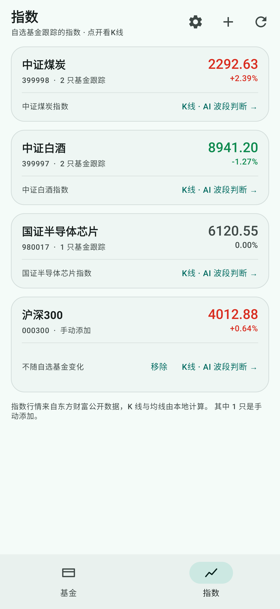
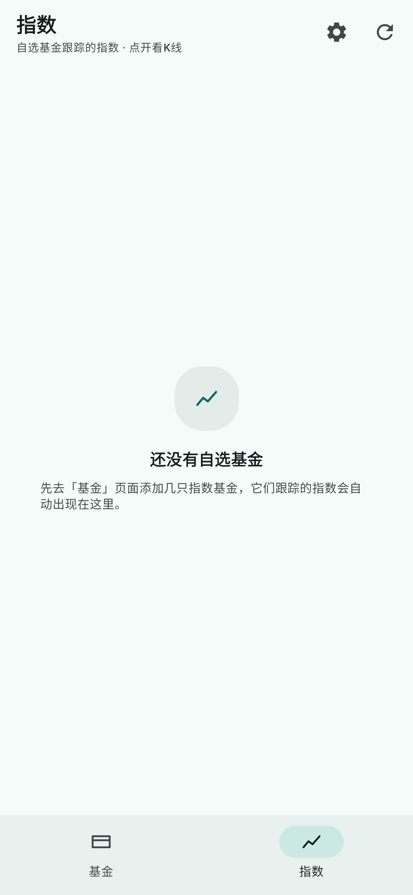
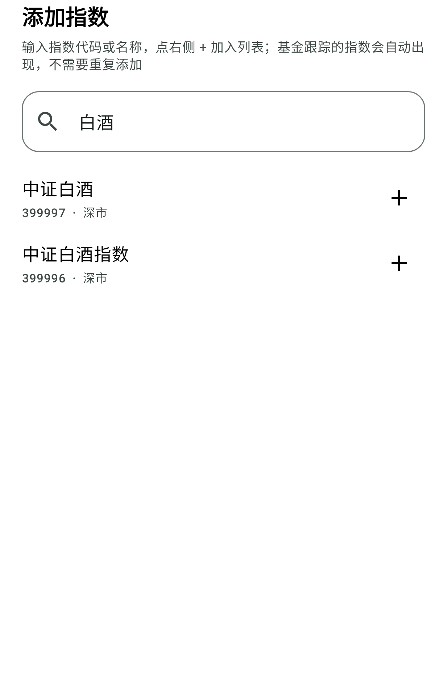

# 基金雷达 · FundRadar

一个基于 **Material Design 3（Material You）** 的安卓基金限额监控应用。

**[⬇ 下载最新安装包（v1.3.0）](https://github.com/hukua1111/fund-radar/releases/latest)** —— 点开 `FundRadar-1.3.0-release.apk` 即可安装。

**只看你关心的基金**：主界面完全由自选列表驱动，不喜欢的基金不会出现。底部两个页签 —— **基金** 看限购，**指数** 看行情。

## 基金页 · 一只基金一张卡片

```
┌────────────────────────────────────────────────┐
│ 招商中证白酒指数(LOF)A                 🔒 限大额 50万 │   ← 左上角：基金名称
│ 161725 · 指数型-股票                              │   ← 右上角：限额情况
│ ────────────────────────────────────────────── │
│ 单位净值      日涨跌      起购       费率           │   ← 下面一行：基金基本信息
│ 0.5676       +5.58%     10元       0.10%         │
└────────────────────────────────────────────────┘
```

| 亮色 | 暗色 |
| --- | --- |
|  |  |

| 空列表（首次打开） | 添加基金 |
| --- | --- |
|  |  |

**刷新后限购有变化的基金会单独置顶列出**：


## 指数页 · 自选基金跟踪的指数 + 手动添加

自选里的指数基金跟踪哪个指数，这里就列哪个（比如招商中证煤炭等权 LOF → 中证煤炭等权 399990）。
一只指数一张卡片：名称、代码、多少只基金在跟踪、最新点位和日涨跌。**点开就是 K 线 + AI 波段判断。**

想盯的指数没有对应基金？点右上角 **＋**，输入代码（`399997`）或名称（`中证白酒`）直接加进来，
卡片上会标「手动添加」，随时可以移除。两种来源混在一起显示，同一个指数不会重复出现。

| 指数列表 | 没有指数基金时 |
| --- | --- |
|  |  |

| 添加指数（名称或代码都行） |
| --- |
|  |

点开任意指数 → 日 K + MA5/10/20/60，一个按钮让 AI 结合均线判断现在该不该做波段：

| K 线 + 均线 + AI 结论 | 还没配置 AI 接口 |
| --- | --- |
|  |  |

**设置页**：填 AI 地址 / 模型 / Key、Bark 推送地址、每日定时判断时间：


## 安装

`dist/FundRadar-1.3.0-release.apk`（已签名，支持 Android 7.0+ / API 24+）。
传输到手机后直接安装，首次打开需要联网。

`dist/FundRadar-1.3.0-debug.apk` 为调试版，便于 `adb logcat` 排查。

**从 1.0.0 / 1.1.0 / 1.2.0 升级**：`applicationId` 和签名证书都没变（`app/release.keystore`），
直接覆盖安装即可，自选列表和设置全部保留，不需要先卸载。

## 怎么用

1. 打开应用 → 点右上角 **+**（或空页面的「添加基金」按钮）；
2. 输入基金代码或名称（如 `161725`、`招商白酒`），从搜索结果里点 **+** 加入；
3. 也可以直接点空页面上的热门基金一键添加；
4. **基金**页：卡片点开是详情，详情底部有 **从自选移除**；
5. **指数**页：点右上角 **+** 可以手动添加任意指数（代码或名称都行），卡片上标「手动添加」，点「移除」删掉；
6. 点一张指数卡片 → K 线 → 底部 **让 AI 判断现在该不该做波段**。

自选列表保存在本地，重装应用才会丢失。基金跟踪的指数不用维护，跟着自选走；手动添加的指数一直保留，直到你移除。

### 开启 AI 判断（三步）

1. 右上角 **齿轮** → 设置页；
2. 填 AI 接口地址、模型、API Key（DeepSeek 默认 `https://api.deepseek.com/v1` + `deepseek-chat`，任何 OpenAI 兼容服务都行），点 **测试连接**；
   - 自建的 `http://192.168.x.x:8080/v1`、`http://160.202.238.171:8080/v1` 也能用：应用已放开 http 明文（见下方「为什么能连 http」），
     地址不带 `http://` 也行，会自动补全；填到 `/chat/completions` 也可以。
3. 想收推送就再填 Bark 地址（`https://api.day.app/你的Key`），点 **发送测试推送** 确认能收到；
4. 需要每天自动判断，就打开 **开启定时判断**，时间默认 `14:35`。

## 功能

- **自选基金**：只显示你添加的基金，数量不限；搜索添加、一键移除，本地持久化。
- **限购变化提醒**：每次刷新都和上一次抓取结果比对，限购状态或单日额度变化的基金**单独置顶列出**（如「限大额 50万 → 暂停申购」）；收紧标红、放宽标绿，点一行直达详情，也可一键清除。
- **限额卡片**：每只基金一张 MD3 卡片，左上角基金名称、右上角限额徽标（限大额 / 暂停申购 / 不限购），下方一行展示单位净值、日涨跌、起购金额、申购费率。
- **限额金额**：不只显示「限大额」，还显示真实单日额度（如「限大额 50万」）。
- **顶部概览**：自选数量 + 限大额 / 暂停申购 / 不限购 三档统计 + 数据更新时间。
- **筛选**：全部 / 限大额 / 暂停申购 / 不限购，本地即时切换，不重复请求。
- **详情面板**：点击卡片弹出 MD3 BottomSheet —— 申购状态、单日限额、起购金额、赎回状态、费率（含原费率）、净值日期、基金公司、基金经理、成立日期、资产规模，可跳转天天基金，也可移除自选。
- **下拉刷新 + 骨架屏 + 离线缓存**：刷新失败自动回退到本地缓存并 Snackbar 提示。
- **深色模式**：完整明暗两套配色；`FundRadarTheme(dynamicColor = true)` 可开启 Android 12+ 动态取色。
- **涨跌配色**：遵循国内习惯，红涨绿跌。
- **底栏两个页签**：**基金**（限购）/ **指数**（行情），MD3 NavigationBar，返回键与手势导航都正常。
- **指数页**：自动列出自选基金跟踪的指数（如 中证煤炭等权 `399990`），卡片显示最新点位与日涨跌，点开进 K 线；
  右上角 **＋** 也能手动添加任意指数（名称或代码搜索），手动项标「手动添加」并可移除，与基金推导出来的自动合并去重。
- **指数搜索**：腾讯 smartbox 开放接口（同时认代码和名称，`v_hint` 里 `ZS` 类型即指数）为主，本地指数目录兜底；
  只输 6 位代码也能加，添加前会用行情接口验证一次，画不出 K 线的代码不会进列表。
- **K 线 + 均线**：指数日 K 蜡烛图叠加 MA5 / MA10 / MA20 / MA60，可切 60 / 120 / 250 日窗口（一次抓 250 天，切换不联网）。
- **AI 波段判断**：K 线界面一个按钮，把最新点位、四条均线、相对 MA20 偏离度、近 5/20/60 日涨跌和最近 10 根 K 线发给 AI，返回「波段买入 / 波段卖出 / 观望 + 置信度 + 理由 + 风险」。AI 不常驻，点了才请求。
- **每日自动判断 + Bark 推送**：到点抓一遍自选基金跟踪的指数，一次请求问完所有指数，结论推送到手机。

## 指数是怎么认出来的

基金详情页只有指数**名字**（跟踪标的），没有代码：

```
跟踪标的：中证煤炭等权指数 | 年化跟踪误差：1.97%
```

东方财富的搜索接口对非浏览器客户端返回空结果，所以应用换个做法：**本地比对指数目录**。
首次进入指数页时拉两份指数列表（缓存 7 天）—— `m:0+t:5`（深市 / 中证系列，957 条）+ `m:1+s:3`（沪市，180 条），
把 `中证煤炭等权指数` 拆成「系列 + 名称」两段（`中证` + `煤炭等权`），在目录里命中 `煤炭等权`（`0.399990`）。

匹配规则是**宁缺勿错**，认不出来就不显示：

- **系列必须一致**：`中证军工` 不会顶替成 `国证军工`，`沪深300` 不会顶替成 `深证300`，`上证50` 不会顶替成 `深证50`；
- **名称要完全相同**，或一方包含另一方且长度差不超过 40%（所以 `新能源` 不会被当成 `新能源汽车`）；
- 目录里写简称的也能兜底认出来（`国证半导体芯片指数` → `国证芯片`），但只在前面几条都不成立时才用。

目录里认不出来的跟踪标的会直接隐藏，绝不会画错指数的 K 线。
主动管理型基金没有跟踪标的，自然也不会出现在指数页。

### 手动添加的指数是怎么搜的

东方财富的搜索接口对非浏览器客户端返回空，指数目录接口又只能「整表下载、不能按关键词查」，
所以手动添加走**腾讯 smartbox**（`smartbox.gtimg.cn/s3/`）：这是一个开放、免鉴权的 suggest 接口，
名称和代码都能搜，返回里 `ZS` 类型就是指数：

```
v_hint="sz~399997~中证白酒~zzbj~ZS^sh~000300~沪深300~hs300~ZS"
       市场 代码    名称      拼音   类型
```

- `sh` → 东财 secid `1.xxx`，`sz` / `bj` → `0.xxx`，行情仍然走原来的东财 K 线接口；
- 同名去重（沪深300 在沪深两边都有挂牌），只留一条；
- 搜不到时回退到本地指数目录做名称/代码匹配，离线也能加已经缓存过的指数；
- 只输 6 位数字且两边都没命中时，直接按代码试一次，`addIndex` 会先拉 5 根 K 线验证，
  验证通过才写进列表——**画不出 K 线的代码加不进来**，名称也以行情接口返回的为准。

## K 线是怎么来的

指数日线来自 `push2his.eastmoney.com` 的日线接口（`secid=0.399990`），真实开高低收 + 成交量，`fqt=1` 前复权。

均线是本地算的：`movingAverage()` 做前缀和滑窗，切窗口时只在已经抓下来的 250 根上切片，**不重复请求**。

## AI 波段判断怎么问的

提示词里只给数字，不给新闻，避免模型编故事：

```
指数：中证煤炭等权（399990）
最新日期：2026-11-05
最新点位：2292.63
均线：MA5=2251.30  MA10=2218.44  MA20=2190.02  MA60=2140.77
现价相对MA20：+4.69%
区间涨跌：近5日=+3.20%  近20日=-1.40%  近60日=-8.70%
最近10个交易日（日期 开高低收）：…
```

要求模型只回一个 JSON：

```json
{"action":"BUY|SELL|HOLD","confidence":0-100,"reason":"60字以内中文理由","risk":"30字以内风险提示"}
```

解析很宽容：带 ```json 代码块、前后夹着客套话、`action` 写成「买入 / 卖出 / 观望」都能认；
实在解析不出来就把模型原文当理由显示，`action` 记为「未判断」，不会崩。

请求走 `POST {base}/chat/completions`，`Authorization: Bearer <key>`，`temperature=0.2`，
读超时 90 秒（推理模型慢也够）。

## 每天 14:35 自动判断

用的是 WorkManager 的**一次性任务 + 自我续期**，不是 `PeriodicWorkRequest`（周期任务只能保证 15 分钟粒度，定不准 14:35）：

1. 打开开关时算出「距离下一个 14:35 还有多少毫秒」，`setInitialDelay` 入队，约束是「有网」；
2. 任务跑完（成功或失败）都会重新排下一天，所以只要应用不被卸载就一直在；
3. WorkManager 自己把任务写进数据库，**手机重启后自动恢复**；应用每次启动也会重新对一遍时间，防止被系统清掉；
4. 任务内部：先算出自选基金跟踪的指数 → 抓每个指数 250 天日线 → **一次请求**让 AI 判断全部指数（最多 12 个，控制 token 和耗时）→ 一条 Bark 推送汇总：

```
指数波段判断 · 11-05 14:35
中证煤炭等权：波段买入 72% · MA5上穿MA20，站上MA20
中证白酒：观望 40% · 均线纠缠，等方向
```

AI 没配置、自选为空、没有指数基金、行情抓不到、接口报错，都会推一条对应提示，不会静默失败。

**关于准时**：Android 的省电策略（Doze、厂商后台限制）会让任务延后，一般误差在 15 分钟内；
想更准可以在系统设置里把这个应用加入「不受限制 / 允许后台活动」。指数是盘中实时变化的，
14:35 判断的是**当天盘中位置**，收盘前还来得及操作对应的场外基金（15:00 前申购按当日净值）。

## 升级说明

- **1.3.0**：`applicationId` 与签名证书不变，可直接覆盖安装 1.0.0 / 1.1.0 / 1.2.0，自选和设置全部保留；
  - `versionCode` 3 → 4，`versionName` 1.2.0 → 1.3.0；
  - 指数页新增「添加指数」（右上角 ＋），手动添加的指数存进 SharedPreferences 的 `manual_indices`，不会与基金推导出来的重复；
  - 新增 `res/xml/network_security_config.xml`，`AndroidManifest` 里加了 `usesCleartextTraffic="true"`——
    修复「测试连接」报 `Cleartext HTTP traffic to 192.168.x.x not permitted`；
  - 没有新增依赖，网络层依旧 `HttpURLConnection` + `org.json`。

## 为什么能连 http（明文）

AI 接口和 Bark 地址都是你自己填的，自建的 OpenAI 兼容服务（Ollama / vLLM / one-api）经常跑在
`http://192.168.x.x:11434` 这种内网明文端口上。Android 9（API 28）起默认禁止明文请求，
报错就是 `Cleartext HTTP traffic to 160.202.238.171 not permitted`。

应用因此在 `res/xml/network_security_config.xml` 里显式放开了 cleartext，并在清单里加了
`android:usesCleartextTraffic="true"`（兼容 API 24–27）。代价是这台设备上所有 http 请求都不再被系统拦截，
所以 API Key 仍只建议填给可信的服务。

地址写歪了也会给具体原因，而不是抛一串英文异常：

| 情况 | 提示 |
| --- | --- |
| 没写协议（`160.202.238.171:8080/v1`） | 自动补 `http://`（IP / localhost）或 `https://`（域名） |
| 域名解析不了 | 找不到服务器 xxx，检查地址拼写 |
| 端口没开 | 连不上 xxx，检查端口是否正确、服务是否在运行 |
| Key 错 | AI 接口返回 HTTP 401：Key 无效或没有权限 |
| 少了 `/v1` | AI 接口返回 HTTP 404：路径不对，常见原因是地址少了 /v1 |

## 数据来源

公开页面（天天基金 / 东方财富），无需鉴权：

| 用途 | 来源 |
| --- | --- |
| 单只基金：名称 / 净值 / 涨跌 / 申购状态 / 限额 / 起购 / 类型 / 费率 / 风险 / 公司 / 经理 / 规模 / 跟踪标的 | `fund.eastmoney.com/{code}.html` |
| 添加基金时的搜索 | `fund.eastmoney.com/Data/Fund_JJJZ_Data.aspx` |
| 添加指数时的搜索（名称 / 代码） | `smartbox.gtimg.cn/s3/`（腾讯，开放接口） |
| 指数目录（名称 → 代码） | `push2.eastmoney.com/api/qt/clist/get` |
| 指数日 K 线（点位 / 涨跌 / 开高低收） | `push2his.eastmoney.com/api/qt/stock/kline/get` |

> 数据仅供研究参考，不构成任何投资建议。接口为第三方公开页面，可能随时变更或限流。

### 为什么解析基金详情页

移动端 JSON 接口 `fundmobapi.eastmoney.com` 字段更全、体积更小（约 3 KB），但它对同一 IP 的连续请求
非常敏感，几十次之后就会返回 `ErrCode 61136403 网络繁忙`；对非浏览器 TLS 指纹的客户端（如 JVM）几乎总是直接拒绝。
基金详情页与列表页同源，实测稳定，一次请求就包含卡片和详情页需要的全部字段，因此作为唯一数据源。

### 限购变化是怎么判断的

每只基金的详情（含申购状态和单日额度）都会连同时间戳缓存下来，刷新时用「缓存里的上一次结果」和
「刚抓到的新结果」比对，比对的是卡片右上角那个徽标文本：

| 变化 | 归类 | 颜色 |
| --- | --- | --- |
| 任意 → 暂停申购 | 暂停申购 | 红 |
| 暂停申购 → 限大额 / 不限购 | 恢复申购 | 绿 |
| 不限购 → 限大额，或额度变少 | 收紧 | 红 |
| 限大额 → 不限购，或额度变多 | 放宽 | 绿 |

徽标文本相同则不算变化；首次添加（没有上一次记录）也不会误报。变化列表只反映**最近一次刷新**，
再次刷新会重新计算，没有变化就自动消失，也可以手动点「清除」。

### 请求策略

- 每只基金一次请求，**最多 3 个并发**；
- 结果缓存 **15 分钟**，缓存命中时刷新不发请求（离线也能看）；
- 连续 3 次失败即停止本轮抓取，剩余基金回退到缓存，卡片降级为状态徽标。

## 技术栈

| 组件 | 版本 |
| --- | --- |
| Kotlin | 2.0.20 |
| Jetpack Compose (BOM) | 2024.09.00 |
| Material 3 | 1.3.0 |
| AGP / Gradle | 8.5.2 / 8.9 |
| WorkManager | 2.9.1 |
| compileSdk / targetSdk / minSdk | 34 / 34 / 24 |
| JDK | 17 |

网络层只用 `HttpURLConnection` + `org.json`，没有引入 OkHttp / Retrofit / Room，依赖极少、构建快。
K 线图是自己用 Compose `Canvas` 画的（蜡烛、均线、坐标轴、网格），没有引入图表库。

## 构建

用 Android Studio 直接打开本目录，或：

```bash
./gradlew assembleDebug      # app/build/outputs/apk/debug/app-debug.apk
./gradlew assembleRelease    # app/build/outputs/apk/release/app-release.apk
./gradlew testDebugUnitTest  # JVM 截图测试，产物在 app/build/screenshots/
```

需要 Android SDK Platform 34 与 Build-Tools 34.0.0。国内网络如果卡在下载 Gradle，可把
`gradle/wrapper/gradle-wrapper.properties` 里的 `distributionUrl` 换成腾讯云镜像：
`https://mirrors.cloud.tencent.com/gradle/gradle-8.9-bin.zip`。

签名：`app/debug.keystore` 与 `app/release.keystore` 为演示用密钥（口令见 `build.gradle.kts`），
正式发布请替换为你自己的 keystore。

## 截图测试

没有模拟器也能看到真实渲染结果：`ScreenshotTest` / `FeatureScreenshotTest` 用 Robolectric 原生图形在 JVM 上渲染 Compose，
并把视图直接绘制成 PNG（`captureToImage()` 在 Robolectric 下不可用，所以走 `View.draw(Canvas)`）。
覆盖亮色、暗色、骨架屏、空自选、添加面板、限购变化、指数页（含空态与手动添加）、添加指数面板、
K 线（含 AI 结论 / 未配置 AI / 暗色）、设置页，
另外会把语义树坐标写进 `tree*.txt`，方便核对布局。

单元测试另外覆盖：均线计算（`KlineTest`）、AI 返回解析（`AiVerdictTest`，含代码块包裹、中文动作词、脏文本兜底）、
定时延迟计算（`DailySchedulerTest`）、限额徽标与变化判定（`FundModelTest`）、
跟踪标的名 → 指数代码的归一化与匹配（`IndexNameTest`）、
smartbox 搜索结果解析 / 本地目录搜索 / AI 地址规范化（`IndexSearchTest`）。

## 目录结构

```
app/src/main/java/com/hukua/fundradar/
├── MainActivity.kt                 入口，edge-to-edge + 底栏两页签 + 列表/设置/K线 路由
├── data/
│   ├── Fund.kt                     领域模型、限额状态推导、格式化工具
│   ├── EastMoneyApi.kt             详情页（HTML）、列表接口、指数目录、指数K线、secid 可用性探测
│   ├── FundRepository.kt           并发抓取、双层缓存、失败熔断
│   ├── IndexCatalog.kt             指数目录模型 + 名称归一化/匹配 + 本地目录搜索 + 7 天磁盘缓存
│   ├── IndexSearchApi.kt           腾讯 smartbox 指数搜索（名称 / 代码），解析 v_hint
│   ├── IndexWatchStore.kt          手动添加的指数持久化（SharedPreferences）
│   ├── IndexRepository.kt          自选 + 手动指数 → 最新点位，添加前校验行情
│   ├── Kline.kt                    Candle / KlineSeries / 均线计算
│   ├── AiAdvisor.kt                OpenAI 兼容调用、提示词、JSON 解析、错误信息中文化
│   ├── BarkNotifier.kt             Bark 推送
│   ├── SettingsStore.kt            AI / Bark / 定时配置持久化 + 地址规范化
│   └── WatchlistStore.kt           自选列表持久化（SharedPreferences）
├── ui/
│   ├── FundViewModel.kt            UiState / 筛选 / 添加 / 移除 / 详情状态机
│   ├── FundListScreen.kt           顶栏、概览、筛选、列表、空态、添加面板
│   ├── FundCard.kt                 卡片 + 限额徽标 + 指标单元格
│   ├── FundDetailSheet.kt          MD3 ModalBottomSheet 详情
│   ├── IndexViewModel.kt           指数列表加载状态机 + 添加/移除手动指数
│   ├── IndexScreen.kt              指数卡片列表 + 空态 + 添加指数面板
│   ├── TabIcons.kt                 底栏两个手写描边图标（不引 material-icons-extended）
│   ├── KlineViewModel.kt           K 线加载 / 窗口切换 / AI 判断状态机
│   ├── KlineScreen.kt              蜡烛图 + 均线 + AI 结论卡片
│   ├── SettingsScreen.kt           AI / Bark / 定时设置
│   └── theme/                      MD3 配色（明/暗）、字阶、涨跌色
└── work/
    ├── DailyScheduler.kt           每天固定时间入队 + 自我续期
    └── DailyCheckWorker.kt         抓指数日线 → 批量问 AI → 推 Bark
```

## 替换成自己的数据源

1. 改 `EastMoneyApi.fetchFundDetail` 与 `fetchList`，分别返回 `FundDetail` / `List<Fund>`；
2. 字段不同就改 `FundDetail.toFund` 里的映射；
3. 卡片、详情、自选列表全部由 `Fund` 驱动，UI 层无需改动。

`LimitType` 的判定规则集中在 `Fund.limitType`：状态含「暂停」→ 暂停申购；含「限」→ 限大额；
含「开放」→ 不限购；额度 ≥ 100 亿视为不限购。
