# 基金雷达 · FundRadar

一个基于 **Material Design 3（Material You）** 的安卓基金助手。底部两个页签，各管一件事：

| 页签 | 放什么 | 看什么 |
| --- | --- | --- |
| **持仓** | 你实际持有的基金，单独一份清单 | 概况 + **盘中估算涨跌**，顶部 **全部 / 持有 / 未持有** 一键切换，不判断限购 |
| **限购** | 另一份清单，只放在意申购额度的基金 | 申购状态、单日限额、限购变化 |

指数不单独列表：每只基金的卡片脚注、详情页的「跟踪标的」里已经写了它跟踪哪个指数，
列表顶上不再重复铺一条「相关指数」横滑条；K 线直接画在基金详情页里。

**[⬇ 下载最新安装包（v1.15.0）](https://github.com/hukua1111/fund-radar/releases/latest)** —— 点开 `FundRadar-1.15.0-release.apk` 即可安装。

**为什么拆成两份清单**：一只基金要不要看限购，和「我今天赚了多少」是两件事。
持仓动辄二三十只，绝大多数都写着「不限购」，混在一起既看不清净值也看不清额度；
限购监控通常只有三五只，是真正要抢额度的那几只。所以两份清单各自维护、互不干扰。

## 持仓页 · 概况 + 盘中估算

基金净值一天只公布一次（晚上），但**它跟踪的指数全天都在跳动**。估值的办法就是找一个
「盘中会动、又和它同源」的东西，按贴合程度排：

**跟踪标的指数 → 目标 ETF → 前十大重仓股 → 最近净值**

指数排第一，是拿一年数据回测出来的结论：场外基金照着指数复制组合，长期偏离只在费率量级；
ETF 的场内价格还夹着溢价/折价，日内反而比净值多一层噪声。目标 ETF 只在指数认不出来
（名称对不上、目录里没有）时兜底，并且会在卡片上注明「标的指数未匹配，改用目标 ETF」。

```
┌──────────────────────────────────────────────────────┐
│ 国泰中证煤炭ETF联接C                                     │
│ 008280 · 指数型-股票                                     │
│ ──────────────────────────────────────────────────── │
│ 2.1532                        -3.21%               ›  │
│ 单位净值                       估算涨跌                  │
│ 按跟踪指数估算 · 中证煤炭 · 11-06 14:02                  │
└──────────────────────────────────────────────────────┘
```

主动基金没有跟踪标的，退一步用**前十大重仓股加权**：每只股票的实时涨跌按持仓占比
加权平均，卡片脚注会写「按重仓股估算（合计 54.2%）」。港股持仓（`NEWTEXCH=116`，
比如腾讯、美团）会走 `hk00700` 的行情，不会被错当成深市股票。

完整链条，**保证卡片上永远有数字**：

| 顺序 | 依据 | 脚注 |
| --- | --- | --- |
| 1 | 跟踪标的指数的实时涨跌 | 按跟踪指数估算 · 中证煤炭 · 11-06 14:02 |
| 2 | 目标 ETF 的实时涨跌（指数没认出来时兜底） | 按目标 ETF 估算 · 煤炭ETF国泰 515220 · 标的指数未匹配 |
| 3 | 前十大重仓股加权（主动基金） | 按重仓股估算（合计 54.2%）· 盘中 |
| 4 | 最近一次公布的净值涨跌 | 最近公布净值 · 10-30（非实时） |

第 4 种不算盘中估算，所以卡片小标题会从「估算涨跌」改成「净值涨跌」，颜色照旧按红涨绿跌。
详情页的「今日估算」里还会把目标 ETF 的当日涨跌摆出来当对照，两者差多少一眼能看到。

**标的指数这条路为什么能走通**：腾讯行情 `qt.gtimg.cn` 只认 `000xxx` / `399xxx`，
中证指数公司自己的 `930xxx` / `931xxx`（比如 931994 电网设备主题）在腾讯、新浪都查不到。
所以指数行情**主用东财的批量接口** `ulist.np/get`（一次问一批，`f2` 最新价、`f3` 涨跌幅、
`f124` 行情时间），**备用腾讯** `qt.gtimg.cn` —— 东财那族主机被掐、或者连续失败进入
60 秒冷却时，沪市 `000xxx` / 深市 `399xxx` 立刻改走腾讯，930/931 这一轮保持上一次的值，
不会闪成「—」。概览卡底部会写清楚这一轮走的是「东方财富」还是「腾讯（备用源）」。

顺带解决了两件事：

- 指数名先用「去后缀 / 去发布方前缀」的几种短写法去搜，`中证电网设备主题指数`
  会依次试到 `电网设备主题` 才命中 —— 完整名字在行情搜索里一条都搜不出来；
- 东财的行情主机按编号分片（`45.push2` / `99.push2` …），不同网络能连通的不一样，
  代码里按顺序试并记住可用的那台。实时轮询只给 3.5 秒预算、最多试两台主机
  （每台 1.5 秒），试不完就交给腾讯，不会把一轮 5 秒的刷新拖死。

> 天天基金官方的盘中估值接口（`fundgz.1234567.com.cn`）已经停止服务，
> 网页上的「净值估算」也退化成 `--`。所以这里的估算全部由交易所实时行情自己算，
> 没有可直接照抄的第三方估值。

| 持仓（总市值 + 估算涨跌） | 限购（另一份清单） | 点开后的二级详情（我的持仓） |
| --- | --- | --- |
| 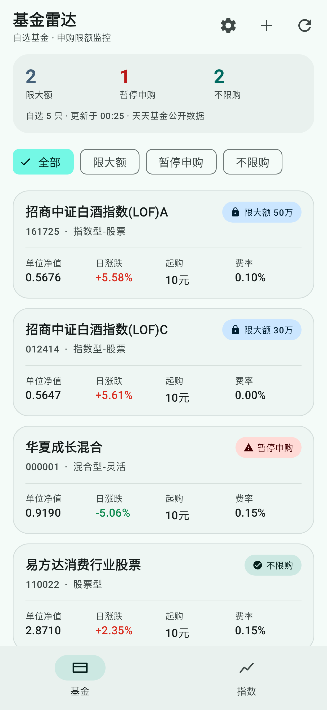 | 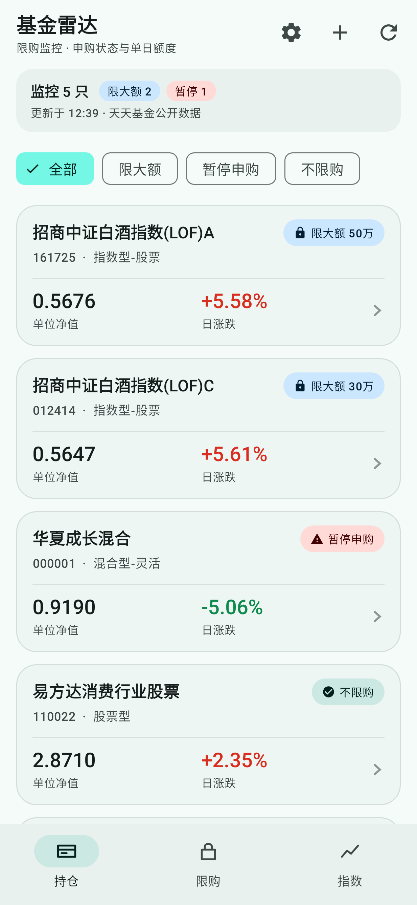 | 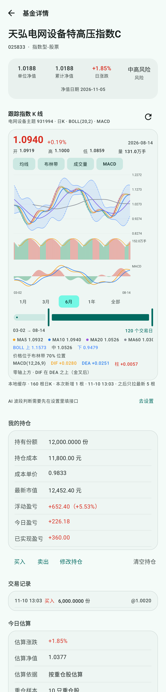 |

| 记账面板（买入 / 卖出 / 修改持仓） | 限购页的详情（限额 + 档案） |
| --- | --- |
| 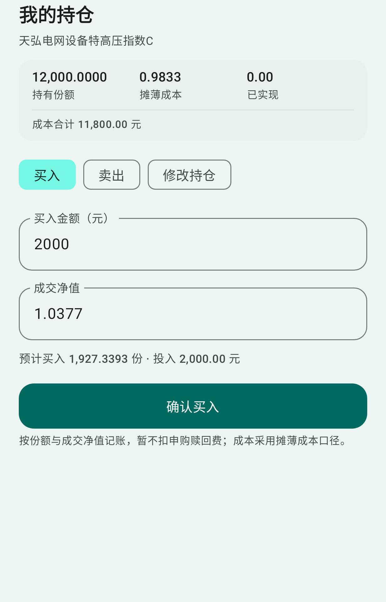 | 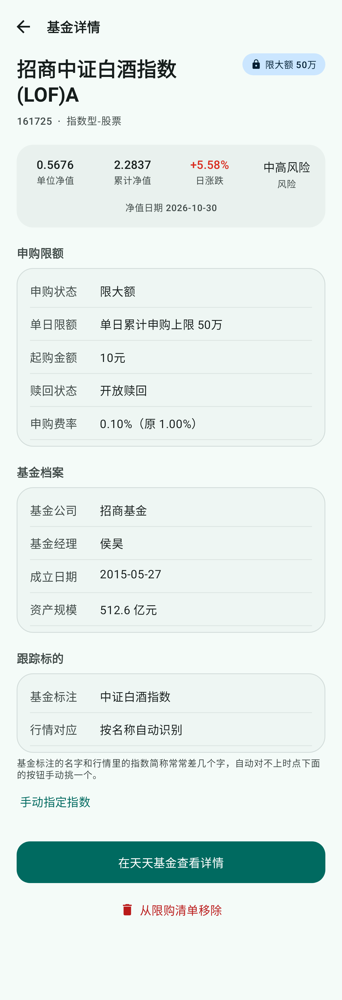 |

| 暗色 |
| --- |
| 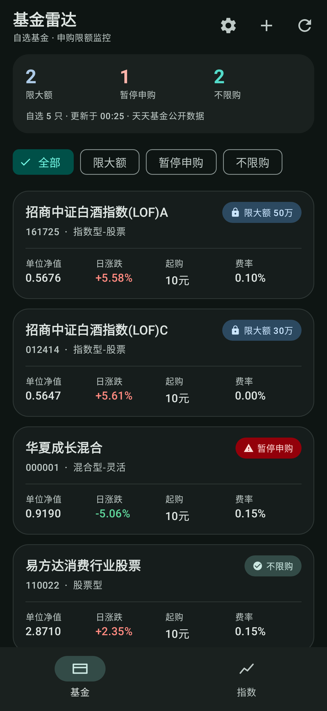 |

| 空持仓（首次打开） | 添加基金 |
| --- | --- |
| 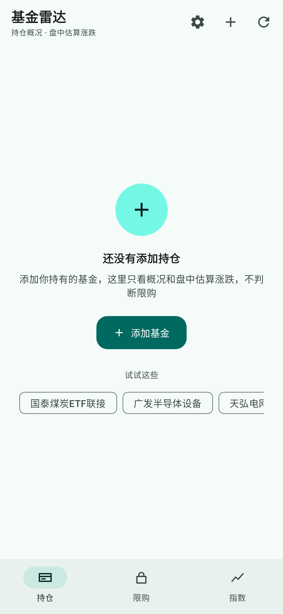 | 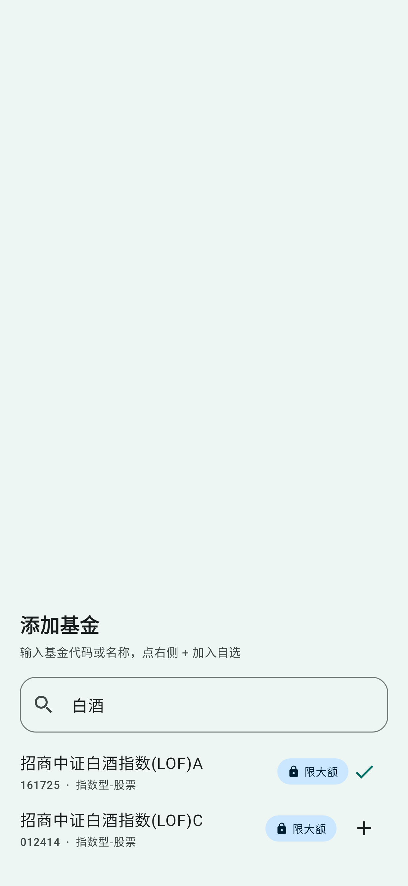 |

**刷新后限购有变化的基金会单独置顶列出**（限购页）：

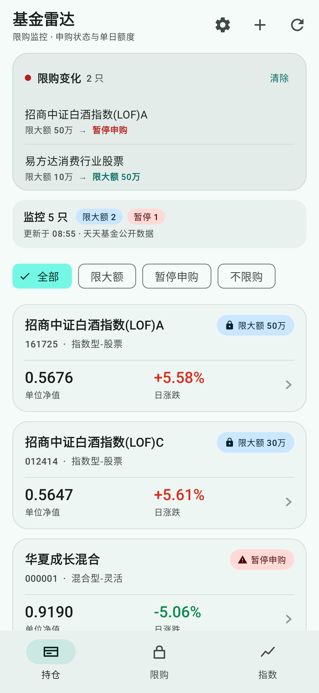

点开卡片是独立的二级详情页，两个页签共用一页但各看各的：

- **持仓**：净值概况 → **我的持仓**（份额 / 成本 / 市值 / 盈亏 / 交易记录）→ 今日估算 → 跟踪标的；
  不显示申购限额，也不显示基金档案。
- **限购**：净值概况 → 今日估算（无）→ 申购限额 → 基金档案 → 跟踪标的。

底部都可以跳天天基金或从当前清单移除。

## 我的持仓 · 份额、成本与盈亏

持仓页的每只基金可以填自己的持仓，卡片和详情页就都按你的真实仓位算钱。

| 入口 | 填什么 | 结果 |
| --- | --- | --- |
| **修改持仓** | 持有份额 + **持仓成本价**（可切成成本金额） | 成本 = 份额 × 成本价，照基金 App 的「持仓成本价」抄即可 |
| **买入** | 买入金额 + 成交净值 | 份额 = 金额 / 净值，成本累加 |
| **卖出** | 卖出份额（可点「全部」）+ 成交净值 | 按当前均价扣成本，差额记入已实现盈亏 |

> **「持有金额」不是成本。** 支付宝 / 天天基金持仓页上的「持有金额」= 份额 × 最新净值，是**市值**；
> 真正的买入成本看「持仓成本价」。以前面板只收「持有金额」，抄进去就把成本记成了市值。
> 现在默认收成本单价，切到金额口径时如果填的数与市值几乎相等，面板会直接标红提醒。
>
> 例：008280 份额 702.97、持有金额 1,513.64、持仓成本价 2.2795 →
> 成本 1,602.42 元、市值 1,513.64 元、浮动盈亏 −88.79（−5.54%）。

算法用的是**摊薄成本**（和基金 App 一致）：

```
成本单价 = 持仓成本 / 持有份额
浮动盈亏 = 份额 × 最新净值 − 持仓成本
浮动收益率 = 浮动盈亏 / 持仓成本
今日盈亏 = 市值 × 涨跌幅 / (100 + 涨跌幅)     ← 反推昨收市值
卖出实现盈亏 = 卖出份额 × 净值 − 卖出份额 × 成本单价
```

- **持仓页概览**：有持仓时顶部显示总市值、今日盈亏、累计盈亏（含收益率）；
- **基金卡片**：精简成「名字 + 估算涨跌 + 一行市值 / 今日 / 累计」，其余数字都收进详情页；
- **详情页**：持有份额、持仓成本、成本单价、最新市值、浮动盈亏、今日盈亏、已实现盈亏，以及最近 6 笔买卖记录；
- 卖出份额超过持有量会被自动封顶，不会出现负仓位；
- 数据存在 `fund_radar` 的 `holdings_v1` 里（每只最多留 100 条记录），覆盖安装不丢，删基金时一起清掉。

> 手续费、分红再投没有单独建模：直接填「实际投入的钱 + 实际确认的份额」，
> 误差会落在成本里，盈亏依然能对上。

## 相关指数 · 跟着基金走，不再单独列一条

每只基金的卡片脚注（`按跟踪指数估算 · 中证煤炭 · 11-06 14:02`）和详情页的「跟踪标的」
里已经写明它跟踪哪个指数，列表顶上再铺一条「相关指数」横滑条只是把同一件事说两遍。
所以这条横条去掉了：持仓页现在直接就是 **持有 / 未持有** 两段基金，概览卡下面还有一个
**全部 / 持有 / 未持有** 的分段选择，点一下只看自己真金白银买的那几只。

想盯的指数没有对应基金？现在不需要单独加指数 —— 加那只基金就行，它的估算和 K 线都按
自己的跟踪标的走；基金名和行情简称对不上时，在详情页「跟踪标的」里手动指定一个指数。

| 持有页（概览 → 分段选择 → 持有 → 未持有） | 只看持有 |
| --- | --- |
| 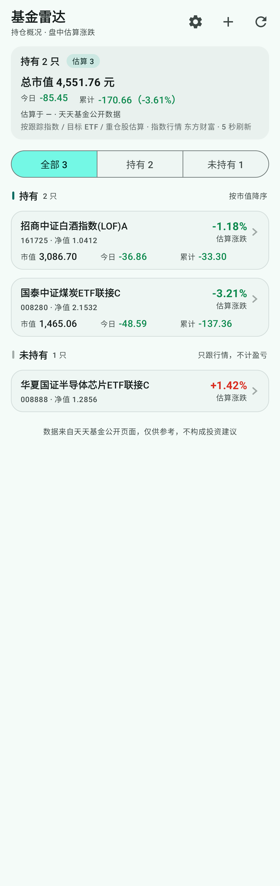 | 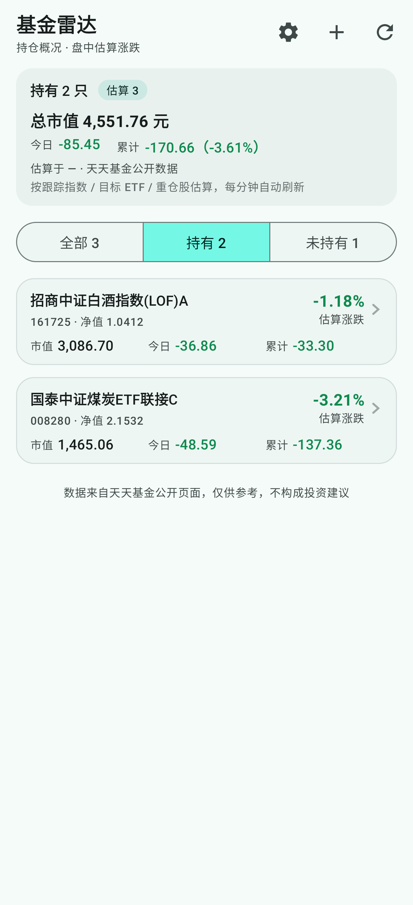 |

打开任意基金，**K 线直接画在详情页里**（净值卡下面），不用再点按钮跳一层：
日 K + MA5/10/20/60 + BOLL(20,2) + MACD + 成交量副图，双滑块框选任意时间段，
长按看单日明细，底部一个按钮让 AI 结合均线与布林带判断现在该不该做波段。
停留在这个页面时，指数点位 **3 秒**刷一次、估值 15 秒一次、当日 K 线 30 秒补一次。

| K 线 + 均线 + 布林带 + 成交量 + 时间滑块 | 还没配置 AI 接口 |
| --- | --- |
| 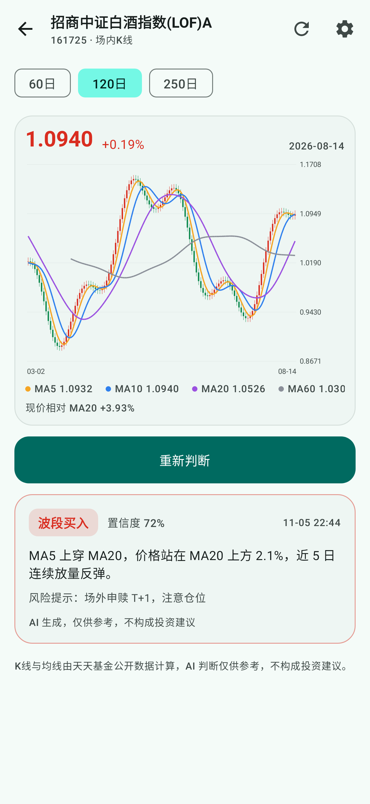 | 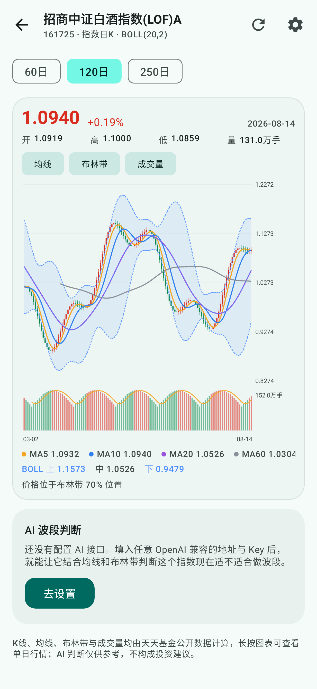 |

| 跟踪标的手动指定 | 暗色 K 线 |
| --- | --- |
| 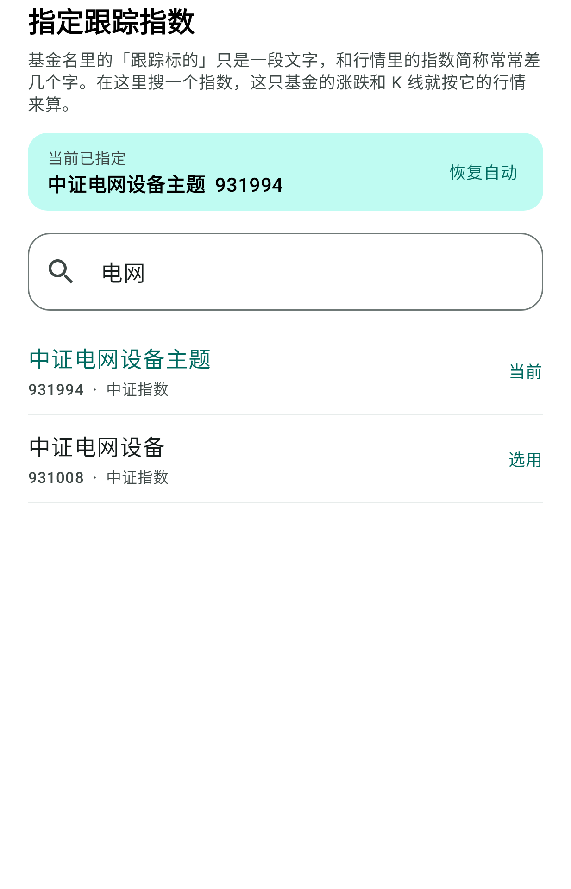 | 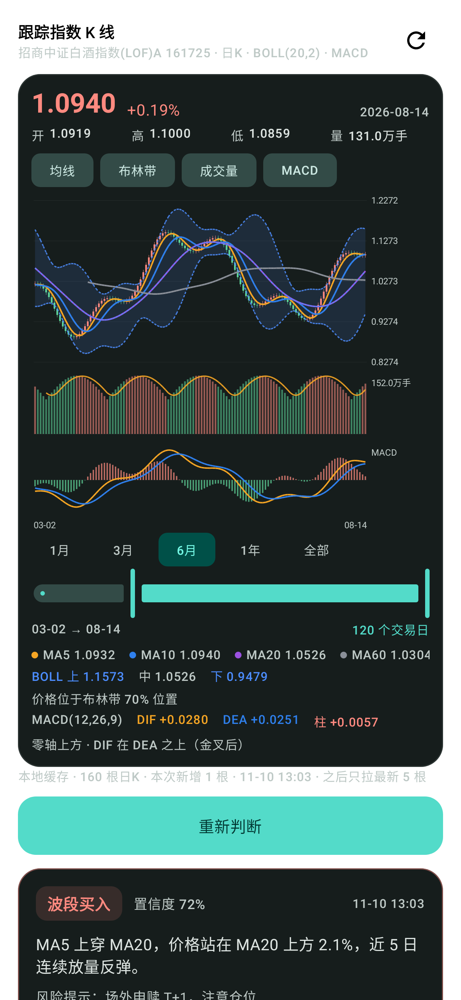 |

**设置页**：填 AI 地址 / 模型 / Key、Bark 推送地址、每日定时判断时间：

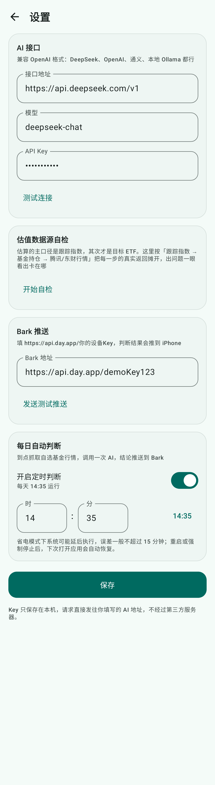

## 安装

从 [Releases](https://github.com/hukua1111/fund-radar/releases/latest) 下载
`FundRadar-1.15.0-release.apk`（已签名，支持 Android 7.0+ / API 24+）。
传输到手机后直接安装，首次打开需要联网。

`FundRadar-1.15.0-debug.apk` 为调试版，便于 `adb logcat` 排查。新版本的包不再提交进
`dist/`（历史 APK 已占了两百多 MB），一律走 Release 附件。

**从 1.0.0 – 1.14.0 升级**：`applicationId` 和签名证书都没变（`app/release.keystore`），
直接覆盖安装即可，自选列表和设置全部保留，不需要先卸载。

## 怎么用

1. 打开应用落在 **持仓** 页 → 点右上角 **+**（或空页面的「添加基金」按钮）；
2. 输入基金代码或名称（如 `008280`、`煤炭ETF`），从搜索结果里点 **+** 加入；
3. 也可以直接点空页面上的推荐基金一键添加；
4. **持仓**页：卡片点开进详情页 →「我的持仓」里点 **修改持仓** 填份额与持有金额，
   之后每笔 **买入 / 卖出** 都记一笔，市值和盈亏自动跟着变；底部可 **从持仓移除**；
5. **限购**页：切到该页签再点 **+** 添加要盯额度的基金；第一次用可以点 **从持仓导入全部** 一键复制；
6. 持仓页按 **持有 / 未持有** 两段排列：填过份额的在上半段（按市值降序），只加进来看估算的在下半段；
   概览卡下面的 **全部 / 持有 / 未持有** 点一下就能只看其中一类，再点「全部」回到两段；
7. 点开任意基金，K 线就在详情页里 → 长按图表看单日行情，底部 **让 AI 判断现在该不该做波段**；
8. 某只基金的跟踪标的没自动认出来？点开它 →「跟踪标的」→「手动指定指数」，搜一个指数钉住即可。

两份基金清单和持仓记录都存在本地，重装应用才会丢失。指数跟着基金走：卡片和详情里的指数都按基金自己的跟踪标的现算，没有单独的指数清单要维护。

### 开启 AI 判断（三步）

1. 右上角 **齿轮** → 设置页；
2. 填 AI 接口地址、模型、API Key（DeepSeek 默认 `https://api.deepseek.com/v1` + `deepseek-chat`，任何 OpenAI 兼容服务都行），点 **测试连接**；
   - 自建的 `http://192.168.x.x:8080/v1`、`http://160.202.238.171:8080/v1` 也能用：应用已放开 http 明文（见下方「为什么能连 http」），
     地址不带 `http://` 也行，会自动补全；填到 `/chat/completions` 也可以。
3. 想收推送就再填 Bark 地址（`https://api.day.app/你的Key`），点 **发送测试推送** 确认能收到；
4. 需要每天自动判断，就打开 **开启定时判断**，时间默认 `14:35`。

## 功能

- **两份基金清单**：**持仓** 和 **限购** 各存各的，数量不限，搜索添加、一键移除，本地持久化；限购页可一键「从持仓导入全部」。
- **限购变化提醒**：每次刷新都和上一次抓取结果比对，限购状态或单日额度变化的基金**单独置顶列出**（如「限大额 50万 → 暂停申购」）；收紧标红、放宽标绿，点一行直达详情，也可一键清除。
- **持仓概况卡**：名称、代码 / 类型、单位净值、**估算涨跌**，外加一行脚注说明估算依据（跟踪指数 / 目标 ETF / 重仓股 + 行情时间）。
- **盘中估算**：优先取**基金跟踪的标的指数**实时涨跌；指数认不出来时退到目标 ETF；主动基金按前十大重仓股加权；
  最后还有最近公布净值兜底，卡片上不会出现「—」。
- **持仓记账**：每只基金可填持有份额与持有金额，记买入 / 卖出，自动算成本单价、市值、浮动盈亏、今日盈亏与已实现盈亏。
- **限购概况卡**：名称、代码 / 类型、单位净值、昨日涨跌，右上角一个徽标带过限额状态。
- **二级详情页**：点卡片进独立页面 —— 单位净值 / 累计净值 / 日涨跌 / 风险，**我的持仓**（份额、成本、市值、盈亏、交易记录）与今日估算；
  限购页另外显示申购状态、单日限额、起购金额、赎回状态、费率（含原费率）、基金公司、基金经理、成立日期、资产规模。
  两页都有跟踪标的，可跳转天天基金，也可移除自选。
- **限额金额**：不只显示「限大额」，还显示真实单日额度（如「限大额 50万」）。
- **顶部概览**：持仓页显示只数与可估算数量；限购页显示只数 + 限大额 / 暂停申购 小徽标 + 更新时间。
- **筛选**（仅限购页）：全部 / 限大额 / 暂停申购 / 不限购，本地即时切换，不重复请求。
- **下拉刷新 + 骨架屏 + 离线缓存**：刷新失败自动回退到本地缓存并 Snackbar 提示。
- **深色模式**：完整明暗两套配色；`FundRadarTheme(dynamicColor = true)` 可开启 Android 12+ 动态取色。
- **涨跌配色**：遵循国内习惯，红涨绿跌。
- **底栏两个页签**：**持仓** / **限购**，MD3 NavigationBar，返回键与手势导航都正常。
- **持有 / 未持有分组 + 快速切换**：持仓页只按「这只基金我到底有没有份额」分两段 —— 填过持仓的排上半段
  （按市值降序），只加进来看估算的排下半段；概览卡下面一条 **全部 / 持有 / 未持有** 分段选择，各带只数，
  点一下只看一类，选到单类时不铺分组标题；某一类为空时对应按钮置灰。
- **精简卡片**：列表里只留基金名、估算涨跌和一行「市值 / 今日 / 累计」，净值与代码缩成一行小字；
  净值、类型、估算依据、持有份额、买卖记录都在详情页，列表不再重复。
- **指数搜索**：东方财富行情搜索接口为主（能搜到 930xxx / 931xxx 这类中证自有代码），
  腾讯 smartbox 与本地目录兜底（两者都认代码和简称）；
  只输 6 位代码也能加，添加前会用行情接口验证一次，画不出 K 线的代码不会进列表。
- **时间范围滑块**：两根滑块框选任意区间，1月 / 3月 / 6月 / 1年 / 全部 一键切换，拖动不联网。
- **指数行情主备双源**：主用东财 `ulist.np`（唯一覆盖 930/931 中证自编指数），
  备用腾讯 `qt.gtimg.cn`；东财主机被掐或连续失败时冷却 60 秒，交易所指数立刻改走腾讯，
  中证指数保持上一次的值，概览卡写明这一轮走的是主源还是备用源。
- **刷新节奏**：列表 5 秒、详情 3 秒（交易时段），午休与收盘后分别降到 60 秒 / 30 秒；
  每轮只发两个批量请求，交易时段一小时不到 1 MB。
- **K 线本地缓存**：首次 800 根落盘（官网能给到上市以来全部），之后每次只补最新 5 根，盘中 2 分钟内不重复请求。
- **历史 K 线主源是中证指数官网**：000 / 930 / 931 段全覆盖，带 PE 与成分股数；当日那根由东财补，深市 399 段仍走东财。
  图下方标明来源与「最新一根」日期。
- **K 线 + 均线 + 布林带**：指数日 K 蜡烛图叠加 MA5 / MA10 / MA20 / MA60 与 **BOLL(20,2)**（上下轨虚线 + 淡蓝填充带），
  默认最近 120 根，用下方滑块或快捷键切到任意区间（切换只在本地切片，不联网）。
- **成交量副图**：K 线下方独立的量能柱（红涨绿跌）+ 5 日均量线，右侧标注窗口内最大量。
- **长按看单日**：按住图表出现十字光标，顶部同步切换成该交易日的开 / 高 / 低 / 收 / 量 / 涨跌幅，底部日期牌跟着走，松手回到最新一根。
- **指标开关**：均线 / 布林带 / 成交量可各自关掉，窄屏或只想看裸 K 时更清爽。
- **跟踪标的手动指定**：基金名对不上行情简称时，在基金详情里搜一个指数钉住它，估算与 K 线立刻按新标的走，可随时恢复自动识别。
- **AI 波段判断**：一个按钮把大盘、板块相对强弱、前十大重仓、四条均线、MACD、布林带、量比、最近 10 根 K 线和我的成本一起发给 AI，
  返回「波段买入 / 波段卖出 / 观望 + 置信度 + 趋势档位 + 理由 + 风险」。AI 不常驻，点了才请求。
- **AI 结论不反复横跳**：指标只用已收盘的日线；提示词带上一次结论和今天改过几次；改口要付代价；
  本地还有滞后带兜底，被拦下时会说明「模型这次倾向买入，但证据没到切换门槛」。卡片上能展开看这一轮完整提示词。
- **每日自动判断 + Bark 推送**：到点抓一遍持仓基金跟踪的指数，一次请求问完所有指数，结论推送到手机。

## 指数是怎么认出来的

基金详情页只有指数**名字**（跟踪标的），没有代码：

```
跟踪标的：中证煤炭等权指数 | 年化跟踪误差：1.97%
```

应用先用**本地指数目录**比对，认不出来再去**东方财富行情搜索接口**按名字反查代码。
首次进入持仓页时拉三份指数列表（缓存 7 天）—— `m:0+t:5`（深市 / 中证系列，957 条）+ `m:1+s:3`（沪市，180 条）
+ `m:2+t:5`（中证指数公司自有代码，930xxx / 931xxx），
把 `中证煤炭等权指数` 拆成「系列 + 名称」两段（`中证` + `煤炭等权`），在目录里命中 `煤炭等权`（`0.399990`）。

**为什么需要第三份列表**：中证指数公司自己发的指数（`中证卫星产业指数 931594`、
`中证电网设备主题指数 931994`、`中证半导体材料设备主题指数 931743`）在行情里的市场码是 `2`，
只抓沪深两组时这些基金的估算是认不出标的的。三组都抓不到时，还会用
`searchapi.eastmoney.com/api/suggest/get` 按跟踪标的名反查（返回的 `QuoteID` 就是 `2.931994`），
结果按名缓存 30 天，所以这些指数的第一次解析要多一个请求，之后不再联网。

> 目录缓存带版本号：老版本写下的缓存会被当作过期，升级后第一次打开就会重抓，不用等 7 天。

名字差几个字是常态（基金写 `中证电网设备主题指数`，行情里叫 `电网设备主题`），
所以反查前会先生成几种短写法：去后缀（`指数` / `全收益` / `净收益` / `R`）、去发布方前缀
（`中证` / `国证` / `深证` / `上证` / `沪深`）、再去掉结尾的 `主题`，按信息量从多到少逐个试。
`中证电网设备主题指数` 最后是靠 `电网设备主题` 命中 `2.931994` 的，完整名字在搜索接口里一条都搜不出来。

匹配规则是**宁缺勿错**，认不出来就不显示：

- **系列必须一致**：`中证军工` 不会顶替成 `国证军工`，`沪深300` 不会顶替成 `深证300`，`上证50` 不会顶替成 `深证50`；
- **名称要完全相同**，或一方包含另一方且长度差不超过 40%（所以 `新能源` 不会被当成 `新能源汽车`）；
- 目录里写简称的也能兜底认出来（`国证半导体芯片指数` → `国证芯片`），但只在前面几条都不成立时才用。

万一某个跟踪标的连搜索接口也认不出来，应用不会硬套一个别的指数：这只基金的估算退到
目标 ETF / 重仓股，详情页暂时不画 K 线，等目录更新或手动指定后再出现。
主动管理型基金没有跟踪标的，本来就走重仓股估算。

**认不出来也不用干等**：点开那只基金 → 下方「跟踪标的」→ **手动指定指数**，
搜代码或名称挑一个，这只基金的估算与 K 线就按你选的指数走，卡片脚注也会换成这个标的，
也不再参与名字匹配；想交回自动识别点「恢复自动识别」。
这条映射存在 `fund_radar` 的 `track_overrides` 里，覆盖安装不会丢。

### 手动指定指数时是怎么搜的

东方财富的搜索接口对非浏览器客户端返回空，指数目录接口又只能「整表下载、不能按关键词查」，
所以手动指定也走**腾讯 smartbox**（`smartbox.gtimg.cn/s3/`）：这是一个开放、免鉴权的 suggest 接口，
名称和代码都能搜，返回里 `ZS` 类型就是指数：

```
v_hint="sz~399997~中证白酒~zzbj~ZS^sh~000300~沪深300~hs300~ZS"
       市场 代码    名称      拼音   类型
```

- `sh` → 东财 secid `1.xxx`，`sz` / `bj` → `0.xxx`，行情仍然走原来的东财 K 线接口；
- 同名去重（沪深300 在沪深两边都有挂牌），只留一条；
- 搜不到时回退到本地指数目录做名称/代码匹配，离线也能挑到已经缓存过的指数；
- 只输 6 位数字且两边都没命中时，直接按代码试一次，`addIndex` 会先拉 5 根 K 线验证，
  验证通过才写进这条映射——**画不出 K 线的代码指定不上**，名称也以行情接口返回的为准。

## 数据源与刷新节奏（实测选型）

指数的实时行情与历史日线都用公开、无 key 的接口。2026-11-10 在本机对常见几家做了
覆盖测试、40 次连发压测和同刻数据比对：

| 实时接口 | 930/931 中证指数 | 延迟中位 | 连发 40 次失败 | 结论 |
| --- | --- | --- | --- | --- |
| 东财 `push2` **ulist.np** | ✅ | 73 ms | 6 次（单主机；轮换主机后更低） | **主用** |
| 腾讯 `qt.gtimg.cn` | ❌ 返回空 | 34 ms | 0 | **备用** |
| 新浪 `hq.sinajs.cn` | ❌ 返回空 | 38 ms | 0 | 不用（与腾讯同覆盖，没有增益） |
| 中证官网 `csindex.com.cn` | ✅ | 实时接口 400 / 500 | — | 实时用不了；**历史日线走它**（见下） |
| 同花顺 `d.10jqka.com.cn` | — | 502 | — | 需浏览器校验 |
| 雪球 `stock.xueqiu.com` | ✅ | 302 | — | 要登录 token |
| akshare / efinance | 底层就是东财、新浪 | — | — | Python 库，Android 不能直接用 |
| baostock | 日线 | TCP 专有协议 | — | 要常驻连接，不适合移动端 |

结论：**能免费、无 key、批量拿到 930/931 的只有东财**，所以它必须是主源；腾讯快一倍多、
限流最松，做备用最合适（代价是只覆盖交易所指数，930/931 那一轮保持上一次的值）。

历史数据同理（2026-11-10 复测，含 930/931 覆盖与历史深度）：

| 历史接口 | 930/931 覆盖 | 历史深度 | 单次耗时 | 结论 |
| --- | --- | --- | --- | --- |
| 中证官网 `index-perf` | ✅ 全有（含东财缺的 930950、930962） | **上市以来全部**（沪深300 6027 根） | 156 ms 中位 / 连发 30 次 0 失败 | **历史段主用** |
| 东财 `push2his` | ✅ 但 930950/930962 没有 | 约 1426 根（5.9 年） | 86–230 ms | **补当日**、深市主用 |
| 新浪 `getKLineData` | ❌ 不支持 | 受 datalen 限制 | 165 ms | 兜底 |
| 腾讯 `ifzq` | — | — | 被 WAF 拦（501） | 不用 |

中证官网给的是**编制方一手数据**：完整 OHLC + 成交股数 + 成交额 + PE（`peg` 字段）+ 成分股数，
而且**同一天的收盘价与东财逐位一致**（000300 / 000001 / 931151 实测最大差 0.0000），
成交量除以 100 也正好等于东财的「手」。所以可以「官网出历史、东财补当日」无缝拼接。

它唯一的缺口是 **T-1**：当天收盘后到次日更新前，最新一行仍是上一个交易日。所以当日那根必须
再用东财补一次。深市 399 段官网不收录（399001 / 399006 / 399303 实测 0 行），这类标的仍走东财。

> 顺带修掉了一个老问题：`930950`（中证偏股型基金）、`930962`（港股通工业）东财根本没有 K 线，
> 以前详情页是空的，现在从官网能正常画出来。

**刷新节奏**（按上面的限流与水包定的）：

| 场景 | 间隔 | 每轮请求 |
| --- | --- | --- |
| 持仓列表（交易时段） | **5 秒** | 东财指数批量 1 次（≤40 只 0.4 KB）+ 腾讯 ETF/重仓股批量 1 次 |
| 持仓列表（午休 / 收盘后） | 60 秒 | 同上 |
| 基金详情（交易时段） | **3 秒** | 单只指数 0.3 KB；估值 15 秒一次；当日 K 线 30 秒补最后几根 |
| 基金详情（午休 / 收盘后） | 30 秒 | 单只指数 0.3 KB |

交易时段每小时约 720 轮、请求量不到 1 MB，远低于会触发限流的频率（实测 6 次/秒连发 40 次：
腾讯 0 失败、东财单主机偶发空回复，已有主机轮换 + 60 秒冷却 + 备用源三层兜底）。

## K 线是怎么来的

**分两段取，因为两家各有一个硬缺口**：

1. **历史段**走中证官网 `csindex-home/perf/index-perf`（000 / 930 / 931 段）—— 编制方一手数据，
   能给到指数上市以来全部日线，还带 PE 和成分股数。`930950`、`930962` 这类东财根本没有的代码，
   在这里是唯一能画出来的源。
2. **当日那根**走东财 `push2his`（官网是 T-1，当天补不上），同时它也是 399 段的整段来源。
3. 东财整体不可用时退回新浪 `CN_MarketDataService.getKLineData`。

三家的同一天收盘价逐位吻合，成交量口径也一致（官网是股，除 100 即东财的「手」），
所以拼接处不会出现台阶。取数顺序写在 `KlineRepository` 里，来源会显示在图下方：

```
本地缓存 · 800 根日K · 中证指数官网 + 东方财富 · 本次新增 1 根 · 11-10 16:02
```

均线是本地算的：`movingAverage()` 做前缀和滑窗，切窗口时只在已经抓下来的 K 线上切片，**不重复请求**。

布林带同样在本地算：`bollingerBands()` 一次滑窗同时累加 Σx 与 Σx²，得到 MA20 与总体标准差，
上/下轨 = 中轨 ± 2σ；一次算完不到 1 毫秒。成交量取日线的第 6 个字段（单位：手）。

MACD 也在本地算：`macd()` 先递推 EMA(12) / EMA(26) 得到 DIF，再对 DIF 做 EMA(9) 得到 DEA，
柱状线取 2 ×（DIF − DEA），和国内行情软件一致。历史不足的头部（前 26 根、再往前 8 根）留空不画，
所以不会出现「一上来就是一条假信号」。副图自带零轴与红绿柱，图例还会把
「零轴上方 · DIF 在 DEA 之上（金叉后）」翻译成一句人话。

**双滑块框选时间范围**：图下方两根滑块可以框住任意一段（默认最近 120 根），
上面 1月 / 3月 / 6月 / 1年 / 全部 一键跳过去；标签实时显示「03-02 → 08-14 · 120 个交易日」。
均线和布林带先在整个历史上算好再切视窗，所以左边缘不会断线，拖动也不重新请求。

**只拉增量，不再每次全量**：第一次取 **800 根**存进 `filesDir/kline/<secid>.json`，
之后每次最多补最后 **5 根**，按日期合并去重（最多留 1200 根，约五年）。
盘中 2 分钟内重复进入直接用本地缓存，收盘后 12 小时内也不再请求；
实在断网时退回缓存并在图下提示「行情接口暂时没有响应，显示本地缓存」。
官网没补到当日时，状态行会写「最新一根 2026-11-05」，不会让人以为数据没更新。

## AI 波段判断怎么问的

只看一条均线判断不了「现在该不该买卖」。点按钮时先把五层数据凑齐，再一次性交给模型
（每层都有超时和容错，缺了哪层会在提示词里写明「本次缺失」，模型不会瞎编）。

**1.13.0 起，技术指标只用「已收盘定型」的日线**，盘中那根单独放一段并注明不能作为改口依据：

```
指数：光伏产业（931151）
行情来源：中证指数官网 + 东方财富（场内交易K线）
技术指标基准日：2026-11-09（已收盘定型）
现在：14:30（盘中，今日这根还没收盘）

【一、大盘环境】
上证指数 3660.79 +0.32%  深证成指 11922.40 -0.18%  创业板指 2410.55 +0.64%  沪深300 4056.11 +0.05% …
6 个宽基里 4 涨 2 跌（只是指数样本，不是全市场涨跌家数）

【二、风格与板块】
标的自身：最近一根（2026-11-09） -0.43%  近5日 -1.61%  近20日 +2.35%  近60日 -2.72%
沪深300 近20日 +1.10%
20日相对沪深300：+2.30 个百分点（强于大盘）

【三、前十大重仓（成分）】
阳光电源 +1.24%  隆基绿能 -0.86%  通威股份 +0.42% …

【四、技术面（全部基于 2026-11-09 收盘，已定型）】
收盘：2235.7061
均线：MA5=2252.8556  MA10=2264.3536  MA20=2252.8965  MA60=2176.2523
收盘相对MA20：-0.76%（贴线，±1% 内属于震荡区）
均线排列：均线纠缠（MA5 与 MA20 相差 0.00%，无方向）
MACD(12,26,9)：DIF=+23.7287  DEA=+30.8695  柱=-14.2816  前一根柱=-10.6189（绿柱放大）
布林带BOLL(20,2)：上轨=2299.6682  中轨=2252.8965  下轨=2206.1248  带宽位置=32%
成交量：最近一根 2629.5万手，5日均量比 1.00（量能持平）
最近10个交易日（日期 开高低收）：…

【五、盘中实时（未定型，只用于判断「现在这个位置」，不能作为改变结论的依据）】
现价 2224.9355，较昨收 -0.48%，相对MA20 -1.24%（实时口径）
今日振幅 1.20%，今日成交量 2065.5万手

【六、我的账户】
光伏产业ETF联接A（012345）：份额 12345.67，成本价 0.8210，市值 9792.79，
浮动盈亏 -343.02（-3.38%），今日 +54.81，估值来源 天天基金·估值

【七、事件与约束】
- 光伏产业ETF联接A（012345）开放申购，最新净值日期 2026-11-09

【八、上一次的判断】
上一次（2026-11-10 10:12）给出：观望（置信度 62），趋势档位：震荡
上次理由：大盘窄幅震荡，光伏板块相对沪深300 略强但量能不足，等站上 MA20 再说。
注意：今天已经改过 1 次方向了。
```

注意「最近一根」这个措辞：基准日是 T-1，写成「今日」会让模型把它当成今天的涨跌，
和下面盘中实时那段自相矛盾。

盘中的实时价不会混进 MA / MACD / BOLL——那些指标只吃定型的日线。这是「反复横跳」最主要的
技术性原因：以前用未收盘的那根算指标，价格每跳一次 MACD 柱就变一次，模型自然跟着改口。

提示词要求它按 **大盘 → 板块相对强弱 → 标的自身技术面 → 我的账户** 的顺序逐层分析，并且：
板块弱于沪深300 时即使形态好也要降置信度；深套时不简单劝割；没持仓就只判断该不该建仓；
缺失的数据必须说明。最后仍然只回一个 JSON（多了 `trend` 字段）：

```json
{"action":"BUY|SELL|HOLD","trend":"UP|RANGE|DOWN","confidence":72,"reason":"80字以内，HOLD 要写清在等什么","risk":"30字以内，买入要写失效价"}
```

提示词从 1.13 的 18 条、1.14 的 15 条，到 1.15 只剩 **8 条**。砍的依据是 40 例逐条消融：
15 条里只有 trend 档位真正改变判断，V0（零规则）→ V8（全量）每加一条规则，每次判断平均 **−0.80pp**。

- **trend 只看「柱有没有连续两根衰竭」**，不再要求单根放大。旧写法里红柱缩一点点就掉出上行档、
  被规则逼成观望——涨得最猛的时候反而不敢买。改成看两根后，14 只 ETF 全历史年化
  **4.81% → 7.02%**，交易次数还少了 20%，回撤没变。
- **trend 阈值 1% → 0.5%，震荡档位允许买入**（1.15）：「RANGE 只能 HOLD」是消融里最大的黑洞——
  40 例里 5 例被判震荡强制观望，后续 20 日合计 **+43%**。现在震荡档可以给 BUY，但必须写清
  「买的是启动不是趋势」和触发条件（站上哪条均线、哪个指标刚转向），写不出来模型自己会给 HOLD；
  本地只把这种买入的置信度压到 55，不改动作。卖出仍然不放行——震荡里的卖出多半是追跌。
- **结论有有效期**：BUY 10 个交易日，SELL / HOLD 5 个。过期后本地不再要求「置信度涨 15 分」
  才准改口，卡片上也会写到哪天失效——否则两周前的一个判断能把后面所有判断钉死。
- **删掉的四样**（1.15）：置信度三项封顶（一次没改变动作，却把量能门槛绑死，机械回测 −3.53pp）、
  板块相对强弱降分（**−2.39pp**）、结合成本、申赎延迟。量能和相对强弱仍然算好摆在数据段里，
  只是不再当硬上限。

> 「普跌日禁止买入」这条写进过 1.14 的中间版本，又被删掉了。全历史回测里它是**负贡献**
> （年化 7.02% → 5.74%），而且触发日次日 ETF 平均还涨 0.14%，比全样本的 +0.03% 略强。
> 现在大盘只做背景标注，规则里明确禁止「拿大盘涨跌单独当理由」。

**这份上下文里有哪些、没有哪些**（宁可说清楚，也不让模型瞎猜）：

| 有 | 没有 |
| --- | --- |
| 6 个宽基指数的实时涨跌与点位 | 全市场涨跌家数、北向资金、两融 |
| 标的与沪深300 的 5/20/60 日涨跌、20 日超额 | 行业估值分位、拥挤度 |
| 前十大重仓股的当日涨跌 | 新闻、公告、研报、财报 |
| 标的的 MA / BOLL / MACD / 量能 | 分钟级资金流、龙虎榜 |
| 我的份额、成本价、浮盈亏、申赎限制 | 分红与除权明细 |

缺的那几类会写进提示词的「本次缺失的数据」，模型被明确要求不许编。

解析很宽容：带 ```json 代码块、前后夹着客套话、`action` 写成「买入 / 卖出 / 观望」都能认；
实在解析不出来就把模型原文当理由显示，`action` 记为「未判断」，不会崩。

请求走 `POST {base}/chat/completions`，`Authorization: Bearer <key>`，`temperature=0`，
读超时 90 秒（推理模型慢也够）。

### 怎么防止它反复横跳

「早上说观望、十点说买入、十点半又说观望」——这是用下来最烦人的问题。原因不止一个，
所以从三处一起改：

| 层 | 做法 | 解决什么 |
| --- | --- | --- |
| 数据 | 指标只用已收盘的日线，盘中价单列 | 价格每跳一次 MACD 就变，模型被迫改口 |
| 提示词 | 把上一次结论、今天改过几次都写进去；改口必须指出具体变化 | 模型「失忆」，每次从零判断 |
| 提示词 | 先定 `trend` 档位，再定动作；震荡只能观望 | 边界样本自由裁量 |
| 本地 | `VerdictStabilizer` 滞后带 | 模型仍然给不同答案时兜底 |

本地的四条规则（`VerdictStabilizer`，全部有单测）：

1. 模型没给出可解析的动作 → 沿用上一次；
2. 说「震荡」却要买卖 → 按震荡处理，动作改观望，置信度压到 55 以下；
3. 想改方向但**置信度没比上次高 15 分**、且**当日涨跌不到 1%** → 维持上一次，卡片上写
   「模型这次倾向『波段买入』，但证据没到切换门槛」；
4. 同一天已经改过一次 → 第二次改口要求置信度 ≥ 75 **且** trend 与动作同向。

结论连同「今天已经改过几次」一起存进 SharedPreferences，关掉 App 再进来仍然记得。
卡片底部还有「查看本轮数据」，可以直接展开看这一轮完整发给模型的内容——包括上一次的结论
和被要求的规矩，不用猜它为什么这么答。

置信度做了平滑（新结论占六成），所以即使动作没变，数字也不会在两个值之间来回跳。

## 每天 14:35 自动判断

用的是 WorkManager 的**一次性任务 + 自我续期**，不是 `PeriodicWorkRequest`（周期任务只能保证 15 分钟粒度，定不准 14:35）：

1. 打开开关时算出「距离下一个 14:35 还有多少毫秒」，`setInitialDelay` 入队，约束是「有网」；
2. 任务跑完（成功或失败）都会重新排下一天，所以只要应用不被卸载就一直在；
3. WorkManager 自己把任务写进数据库，**手机重启后自动恢复**；应用每次启动也会重新对一遍时间，防止被系统清掉；
4. 任务内部：先算出自选基金跟踪的指数 → 抓每个指数 250 天日线 → **一次请求**让 AI 判断全部指数（最多 12 个，控制 token 和耗时）→ 一条 Bark 推送汇总：

```
指数波段判断 · 11-05 14:35
中证煤炭等权：波段买入 72% · MA5上穿MA20，站上MA20
中证白酒：观望 40% · 均线纠缠，等方向
```

AI 没配置、自选为空、没有指数基金、行情抓不到、接口报错，都会推一条对应提示，不会静默失败。

**关于准时**：Android 的省电策略（Doze、厂商后台限制）会让任务延后，一般误差在 15 分钟内；
想更准可以在系统设置里把这个应用加入「不受限制 / 允许后台活动」。指数是盘中实时变化的，
14:35 判断的是**当天盘中位置**，收盘前还来得及操作对应的场外基金（15:00 前申购按当日净值）。

## 升级说明

- **1.15.0**：`applicationId` 与签名证书不变，可直接覆盖安装 1.0.0 – 1.14.0，基金、持仓、设置全部保留；
  - **提示词 15 条砍到 8 条**：40 例逐条消融显示只有 trend 档位真正影响判断，其余多数在劝你别动；
  - **震荡档允许买入**：`RANGE 只能 HOLD` 改成「可以买，但要写清买的是启动 + 触发条件」，
    本地不再把这类买入改写成观望，只压置信度到 55；卖出仍不放行；
  - **trend 阈值 1% → 0.5%**：原来偏离 1% 以内一律算震荡，等于把刚启动的那一段全让掉；
  - **删掉置信度三项封顶、板块相对强弱降分**：前者一次没改变动作却绑死量能门槛（−3.53pp），
    后者机械回测 −2.39pp；量能和相对强弱仍然算好摆在数据段，只是不再当硬上限；
  - 40 例 A/B 盲测（同批样本、只换规则层）：20 日命中 25% → **30%**，照做收益 +7.53% → **+37.47%**，
    多空收益 −14.00% → **+19.52%**；配对检验 p=0.688，属于方向一致但样本还不够大的证据。

- **1.14.0**：`applicationId` 与签名证书不变，可直接覆盖安装 1.0.0 – 1.13.0，基金、持仓、设置全部保留；
  - **提示词按回测重写**：trend 改成看「最近两根柱有没有连续衰竭」；置信度按「档位 + 量能 + 相对强弱」
    三档封顶；结论加有效期（BUY 10 个交易日、SELL/HOLD 5 个）；
  - **删掉了「普跌日禁止买入」**：全历史回测是负贡献（年化 7.02% → 5.74%），大盘现在只做背景标注；
  - **卡片上写明有效期**，过期后本地不再拿「涨 15 分」卡住改口；
  - 18 例盲测（新标的、新时点）动作命中 33% → 44%，照做收益 +0.70% → +2.06%。

- **1.13.0**：`applicationId` 与签名证书不变，可直接覆盖安装 1.0.0 – 1.12.0，基金、持仓、设置全部保留；
  - **历史 K 线改走中证指数官网**：编制方一手数据，能给到指数上市以来全部日线（沪深300 6027 根，
    原来是东财的 1426 根）；同一天的收盘价与东财逐位一致，成交量除以 100 即东财的「手」；
    当日那根仍由东财补，深市 399 段仍走东财。顺带修好了 `930950`、`930962` 这两类
    东财根本没有 K 线的代码（以前详情页是空的）；
  - **首次拉取从 250 根提到 800 根**，缓存上限 500 → 1200 根（约五年）；老缓存没有来源标记，
    会自动重建一次，之后照旧只补尾巴；
  - **K 线下方标出来源**：「中证指数官网 + 东方财富」，官网没补到当日时会写「最新一根 2026-11-05」；
  - **AI 判断不再反复横跳**：技术指标只用已收盘定型的日线，盘中价单列；提示词带上一次结论
    和今天改过几次；先定趋势档位再定动作；`temperature` 0.2 → 0；本地加滞后带兜底。
    结论被拦下来时会说明「模型这次倾向买入，但证据没到切换门槛」；
  - **卡片上能看提示词**：AI 结论下方「查看本轮数据」，直接展开这一轮完整发给模型的内容。

- **1.12.0**：`applicationId` 与签名证书不变，可直接覆盖安装 1.0.0 – 1.11.0，基金、持仓、设置全部保留；
  - **指数行情主备双源**：主用东方财富批量接口（唯一覆盖 930/931 中证自编指数），
    备用腾讯 `qt.gtimg.cn`；东财主机被掐或连续失败时进入 60 秒冷却，交易所指数立刻改走腾讯，
    中证指数保持上一次的值。概览卡会写明这一轮走的是主源还是备用源；
  - **刷新节奏按实测限流定**：列表 5 秒一轮（指数 0.4 KB + ETF/重仓股批量 1 次），
    详情页 3 秒一轮（单只 0.3 KB）；午休与收盘后分别降到 60 秒 / 30 秒；
  - **K 线直接画在基金详情里**：不再点「看这个指数的 K 线」跳一整页，图表就铺在净值卡下面，
    区间滑块、均线 / 布林带 / MACD / 成交量开关、AI 判断都在原位；独立的 K 线页已删掉；
  - **历史 K 线备用源**：东财 `push2his` 不通时自动退回新浪 `getKLineData`。

- **1.11.0**：`applicationId` 与签名证书不变，可直接覆盖安装 1.0.0 – 1.10.0，基金、持仓、设置全部保留；
  - **持仓页加分段选择**：概览卡下面一条 `全部 / 持有 / 未持有`，各带只数，点一下只看一类；
    某一类为空时该段置灰，选到单类时不再铺分组标题；
  - **基金卡片精简**：只留基金名、估算涨跌和一行「市值 / 今日 / 累计」，净值与代码缩成一行小字，
    估算依据、类型、份额、买卖记录都留在详情页 —— 一屏能多看两三只。
- **1.10.0**：`applicationId` 与签名证书不变，可直接覆盖安装 1.0.0 – 1.9.0，基金、持仓、设置全部保留；
  - **去掉持仓页顶部的「相关指数」横滑条**：指数信息在基金卡片脚注和详情页「跟踪标的」里已经有，
    列表里不再重复；K 线入口保留在基金详情（「看这个指数的 K 线」），后台只解析「基金 → 指数」映射，不再为每个指数拉行情；
  - **基金列表按「持有 / 未持有」分成两段**：填过份额的排上半段并按市值降序，只加进来看估算的排下半段，
    概览卡从「持仓 N 只」改成「持有 N 只 + 未持有 N 只」，一眼能分清哪些是真金白银、哪些只是自选。

- **1.9.0**：`applicationId` 与签名证书不变，可直接覆盖安装 1.0.0 – 1.8.0，基金、指数、持仓、设置全部保留；
  - `versionCode` 10 → 11，`versionName` 1.8.0 → 1.9.0；
  - **估值口径改为「跟踪指数优先」**：拿一年数据回测，场外基金用标的指数估比用联接 ETF 更贴净值
    （ETF 的场内价格还夹着溢价/折价）。现在的顺序是 跟踪指数 → 目标 ETF → 重仓股 → 最近净值，
    ETF 只在指数认不出来时兜底，并在脚注注明「标的指数未匹配，改用目标 ETF」；
  - 详情页「今日估算」拆成「估算依据 / 跟踪指数 / 目标 ETF（参考）」三行，ETF 那行带当日涨跌，
    两个口径差多少一眼能看到；
  - **指数页并入持仓页**：底栏从三项减到两项（持仓 / 限购），指数变成概览卡下面的横滑条 ——
    名称、点位、涨跌、几只基金跟踪，点开进 K 线；手动添加的指数在条尾 ＋ 里加，卡片右上角 × 移除；
  - 基金详情页「跟踪标的」新增「看这个指数的 K 线」，K 线返回直接回到该基金，不再跳回列表。

- **1.8.0**：`applicationId` 与签名证书不变，可直接覆盖安装 1.0.0 – 1.7.0，基金、指数、持仓、设置全部保留；
  - `versionCode` 9 → 10，`versionName` 1.7.0 → 1.8.0；
  - **持仓成本改为按「持仓成本价」录入**（可切换成本金额）：基金 App 上的「持有金额」是**市值**，
    以前照着抄会把成本记成市值，盈亏全错；现在默认填成本单价，并在金额口径下检测到「≈市值」时直接提示；
  - **修复「估值全是标的指数」的根因**：基金持仓接口 `fundmobapi` 会拒绝桌面 Chrome 的 UA，
    稳定返回 `ErrCode 61136403 网络繁忙`（不是真的繁忙），于是 `ETFCODE` 一直取不到、联接基金全走了指数兜底。
    改用移动端 UA 后，实测 `008280 → 煤炭ETF国泰 515220`、`011609 → 科创50ETF易方达 588080`、
    `020640 → 半导体设备ETF广发 560780` 都能走 ETF 路径；
  - **目标 ETF 兜底行情**：腾讯 `qt.gtimg.cn` 没返回的代码自动补一次东财批量行情，
    联接基金的估算不再因为一个域名不通就掉回标的指数；
  - 详情页新增「目标 ETF」一行，标注它是否有实时行情；估值降级时脚注写明「目标ETF 515220 行情暂缺」；
  - 设置页新增**估值数据源自检**：把「基金持仓 → 腾讯行情 → 东财行情 → 标的指数」四步的真实返回摊开；
  - K 线新增 **MACD(12,26,9)** 副图（零轴 + 红绿柱 + DIF/DEA，含金叉死叉一句话说明）；
  - AI 判断的输入扩成**五层**：大盘（6 个宽基）→ 风格/板块相对强度（对沪深300 的 20 日超额）→
    前十大重仓股实时涨跌 → 标的 MA/BOLL/MACD → 我的账户成本与申购限制；
  - 测试 117 → 130，全部通过；没有新增依赖。

- **1.7.0**：`applicationId` 与签名证书不变，可直接覆盖安装 1.0.0 – 1.6.0，基金、指数、设置全部保留；
  - `versionCode` 8 → 9，`versionName` 1.6.0 → 1.7.0；
  - **持仓记账**：每只基金可填持有份额与持有金额，记买入 / 卖出，自动算市值、浮动盈亏、今日盈亏、已实现盈亏；
    持仓页概览与卡片都带上金额，详情页另有最近 6 笔交易记录；
  - **持仓页详情瘦身**：不再显示申购限额与基金档案（限购页照旧），点开也不用再请求基金页；
  - **估算改按跟踪关系走**：目标 ETF → **跟踪标的指数** → 重仓股 → 最近公布净值；
    指数行情改走东财批量接口，`930xxx` / `931xxx` 这类中证自有代码终于能算；
  - 跟踪标的名新增「短写法」反查（去后缀 / 去发布方前缀 / 去「主题」），`中证电网设备主题指数`
    现在能自动认到 `931994`，不用每次手动指定；
  - 东财行情主机支持按编号分片重试，`push2.eastmoney.com` 被拦时也能出数；
  - 测试 115 → 117，全部通过；没有新增依赖。

- **1.6.0**：`applicationId` 与签名证书不变，可直接覆盖安装 1.0.0 – 1.5.0，基金、指数、设置全部保留；
  - `versionCode` 7 → 8，`versionName` 1.5.0 → 1.6.0；
  - K 线新增**双滑块时间范围**（配 1月 / 3月 / 6月 / 1年 / 全部 快捷键）；
  - K 线改为**本地缓存 + 增量拉取**：首次 250 根落盘，之后每次最多 5 根，盘中 2 分钟 / 收盘 12 小时内不重复请求；
  - 估算新增**港股持仓**（`hk00700`）支持，并加了**标的指数**与**最近公布净值**两级兜底，卡片不再出现「—」；
  - 持仓页估算**每 60 秒自动刷新**（非交易时段 5 分钟），页面不在前台自动暂停；
  - 行情接口 HTTPS 失败时自动退回 HTTP 重试；
  - 没有新增依赖。

- **1.5.0**：`applicationId` 与签名证书不变，可直接覆盖安装 1.0.0 – 1.4.0，基金、指数与设置全部保留；
  - `versionCode` 6 → 7，`versionName` 1.4.0 → 1.5.0；
  - 基金详情「跟踪标的」新增 **手动指定指数**：基金名和行情简称对不上时不用再干等自动匹配，
    指定结果存在 `track_overrides`，指数页会标「手动指定」；
  - K 线图重做：**布林带 BOLL(20,2)**、成交量副图（含 5 日均量线）、长按十字光标 + 单日 OHLC、
    均线 / 布林带 / 成交量三个开关；
  - AI 判断的输入多了布林带上下轨与带宽位置；
  - 没有新增依赖。

- **1.4.0**：`applicationId` 与签名证书不变，可直接覆盖安装 1.0.0 – 1.3.1，基金与设置全部保留；
  - `versionCode` 5 → 6，`versionName` 1.3.1 → 1.4.0；
  - 原来那一份基金列表**原样变成「持仓」页**（沿用了旧的 `watchlist` 键，不用重新添加），
    新增独立的「限购」清单（`limit_watchlist`，初始为空，可一键从持仓导入）；
  - 持仓卡片改为显示**估算涨跌**，不再显示限购徽标；限购页保持原来的徽标 + 筛选 + 变化提示；
  - 估算来源：联接基金取目标 ETF 实时涨跌（`ETFCODE`），其余取前十大重仓股加权；
  - 持仓页每次切回来会重算估算（只发一次腾讯批量行情请求，不重抓基金页）；
  - 没有新增依赖。

- **1.3.1**：`applicationId` 与签名证书不变，可直接覆盖安装 1.0.0 / 1.1.0 / 1.2.0 / 1.3.0，自选和设置全部保留；
  - `versionCode` 4 → 5，`versionName` 1.3.0 → 1.3.1；
  - 基金列表改为**概况卡**，点卡片进独立的**二级详情页**（原来的 BottomSheet 已删除）；
  - 修复「指数页只有中证煤炭、其他基金跟踪的指数不出现」：指数目录补抓 `m:2+t:5`（中证自有代码），
    并在匹配失败时用行情搜索接口按名字反查，目录缓存加了版本号，升级后自动重抓；
  - 指数页底部会说明还有几只基金的跟踪指数没识别出来，不再静默消失。

- **1.3.0**：`applicationId` 与签名证书不变，可直接覆盖安装 1.0.0 / 1.1.0 / 1.2.0，自选和设置全部保留；
  - `versionCode` 3 → 4，`versionName` 1.2.0 → 1.3.0；
  - 指数页新增「添加指数」（右上角 ＋），手动添加的指数存进 SharedPreferences 的 `manual_indices`，不会与基金推导出来的重复；
  - 新增 `res/xml/network_security_config.xml`，`AndroidManifest` 里加了 `usesCleartextTraffic="true"`——
    修复「测试连接」报 `Cleartext HTTP traffic to 192.168.x.x not permitted`；
  - 没有新增依赖，网络层依旧 `HttpURLConnection` + `org.json`。

## 为什么能连 http（明文）

AI 接口和 Bark 地址都是你自己填的，自建的 OpenAI 兼容服务（Ollama / vLLM / one-api）经常跑在
`http://192.168.x.x:11434` 这种内网明文端口上。Android 9（API 28）起默认禁止明文请求，
报错就是 `Cleartext HTTP traffic to 160.202.238.171 not permitted`。

应用因此在 `res/xml/network_security_config.xml` 里显式放开了 cleartext，并在清单里加了
`android:usesCleartextTraffic="true"`（兼容 API 24–27）。代价是这台设备上所有 http 请求都不再被系统拦截，
所以 API Key 仍只建议填给可信的服务。

地址写歪了也会给具体原因，而不是抛一串英文异常：

| 情况 | 提示 |
| --- | --- |
| 没写协议（`160.202.238.171:8080/v1`） | 自动补 `http://`（IP / localhost）或 `https://`（域名） |
| 域名解析不了 | 找不到服务器 xxx，检查地址拼写 |
| 端口没开 | 连不上 xxx，检查端口是否正确、服务是否在运行 |
| Key 错 | AI 接口返回 HTTP 401：Key 无效或没有权限 |
| 少了 `/v1` | AI 接口返回 HTTP 404：路径不对，常见原因是地址少了 /v1 |

## 数据来源

公开页面（天天基金 / 东方财富），无需鉴权：

| 用途 | 来源 |
| --- | --- |
| 单只基金：名称 / 净值 / 涨跌 / 申购状态 / 限额 / 起购 / 类型 / 费率 / 风险 / 公司 / 经理 / 规模 / 跟踪标的 | `fund.eastmoney.com/{code}.html` |
| 添加基金时的搜索 | `fund.eastmoney.com/Data/Fund_JJJZ_Data.aspx` |
| 手动指定跟踪指数时的搜索（名称 / 代码，含 930xxx / 931xxx） | `searchapi.eastmoney.com/api/suggest/get`（东财行情搜索，公开 token） |
| 手动指定跟踪指数的备用搜索 | `smartbox.gtimg.cn/s3/`（腾讯，开放接口） |
| 指数目录（名称 → 代码） | `push2.eastmoney.com/api/qt/clist/get`（`m:0+t:5` + `m:1+s:3` + `m:2+t:5`，按分片主机重试） |
| 指数实时行情（估算用，含 930xxx / 931xxx） | `{45,99,23,82}.push2.eastmoney.com/api/qt/ulist.np/get` |
| 指数日 K 线（历史段主源，000/930/931 段，含 PE 与成分股数） | `csindex.com.cn/csindex-home/perf/index-perf` |
| 指数日 K 线（当日那根 + 深市 399 段） | `push2his.eastmoney.com/api/qt/stock/kline/get` |
| 指数日 K 线（最后兜底） | `quotes.sina.cn/cn/api/jsonp_v2.php/…/getKLineData` |
| 基金持仓（目标 ETF / 前十大重仓股 + 权重） | `fundmobapi.eastmoney.com/FundMNewApi/FundMNInverstPosition` |
| ETF / 个股实时行情（估算用，主源） | `qt.gtimg.cn/q=`（腾讯，一次可问几十个代码，GBK） |
| ETF / 个股实时行情（腾讯没返回时补一次） | `{45,99,23,82}.push2.eastmoney.com/api/qt/ulist.np/get`（`1.515220` / `0.159819`） |
| 大盘快照（AI 判断用） | 同上，一次问 000001 / 399001 / 399006 / 000300 / 000905 / 000688 |

> 数据仅供研究参考，不构成任何投资建议。接口为第三方公开页面，可能随时变更或限流。

### 估值链路怎么自查

「估算涨跌」要连过四关，任何一关断了，界面上看起来都只是「按标的指数估算」，分不清原因。
设置页 → **估值数据源自检** 会依次跑：

1. 基金持仓接口 —— 拿目标 ETF（例：`008280 → 目标 ETF 煤炭ETF国泰 515220`）；
2. 腾讯行情 —— 直接查这个 ETF 的实时涨跌；
3. 东财行情 —— 同一个代码再查一次（腾讯不通时的备份）；
4. 标的指数 —— 基金 → 指数的映射与指数行情。

哪一行是 ✗，就是那一层的问题。估算顺序是
**跟踪指数 → 目标 ETF → 重仓股 → 最近公布净值**：指数没认出来时会退到目标 ETF，
脚注写明「标的指数未匹配，改用目标 ETF」，这时候先看第 4 步的指数映射，
再去基金详情里手动指定一个指数。

### 为什么解析基金详情页

移动端 JSON 接口 `fundmobapi.eastmoney.com` 字段更全、体积更小（约 3 KB），但它对同一 IP 的连续请求
非常敏感，几十次之后就会返回 `ErrCode 61136403 网络繁忙`；对非浏览器 TLS 指纹的客户端（如 JVM）几乎总是直接拒绝。
基金详情页与列表页同源，实测稳定，一次请求就包含卡片和详情页需要的全部字段，因此作为唯一数据源。

### 限购变化是怎么判断的

每只基金的详情（含申购状态和单日额度）都会连同时间戳缓存下来，刷新时用「缓存里的上一次结果」和
「刚抓到的新结果」比对，比对的是卡片右上角那个徽标文本：

| 变化 | 归类 | 颜色 |
| --- | --- | --- |
| 任意 → 暂停申购 | 暂停申购 | 红 |
| 暂停申购 → 限大额 / 不限购 | 恢复申购 | 绿 |
| 不限购 → 限大额，或额度变少 | 收紧 | 红 |
| 限大额 → 不限购，或额度变多 | 放宽 | 绿 |

徽标文本相同则不算变化；首次添加（没有上一次记录）也不会误报。变化列表只反映**最近一次刷新**，
再次刷新会重新计算，没有变化就自动消失，也可以手动点「清除」。

### 请求策略

- 每只基金一次请求，**最多 3 个并发**；
- 盘中估算每 **60 秒**刷新一次（腾讯一批行情 + 东财一批指数，持仓缓存 7 天），非交易时段 5 分钟；
- 东财行情主机按编号分片，第一次成功的那台会被记住，后面优先用它，避免每次都在超时上耗时间；
- 指数日 K 首次 250 根落盘，之后每次最多补 5 根，盘中 2 分钟内直接用缓存；
- 结果缓存 **15 分钟**，缓存命中时刷新不发请求（离线也能看）；
- 连续 3 次失败即停止本轮抓取，剩余基金回退到缓存，卡片降级为状态徽标。

## 技术栈

| 组件 | 版本 |
| --- | --- |
| Kotlin | 2.0.20 |
| Jetpack Compose (BOM) | 2024.09.00 |
| Material 3 | 1.3.0 |
| AGP / Gradle | 8.5.2 / 8.9 |
| WorkManager | 2.9.1 |
| compileSdk / targetSdk / minSdk | 34 / 34 / 24 |
| JDK | 17 |

网络层只用 `HttpURLConnection` + `org.json`，没有引入 OkHttp / Retrofit / Room，依赖极少、构建快。
K 线图是自己用 Compose `Canvas` 画的（蜡烛、均线、布林带、成交量、十字光标、坐标轴、网格），没有引入图表库。

## 构建

用 Android Studio 直接打开本目录，或：

```bash
./gradlew assembleDebug      # app/build/outputs/apk/debug/app-debug.apk
./gradlew assembleRelease    # app/build/outputs/apk/release/app-release.apk
./gradlew testDebugUnitTest  # JVM 截图测试，产物在 app/build/screenshots/
```

需要 Android SDK Platform 34 与 Build-Tools 34.0.0。国内网络如果卡在下载 Gradle，可把
`gradle/wrapper/gradle-wrapper.properties` 里的 `distributionUrl` 换成腾讯云镜像：
`https://mirrors.cloud.tencent.com/gradle/gradle-8.9-bin.zip`。

签名：`app/debug.keystore` 与 `app/release.keystore` 为演示用密钥（口令见 `build.gradle.kts`），
正式发布请替换为你自己的 keystore。

## 截图测试

没有模拟器也能看到真实渲染结果：`ScreenshotTest` / `FeatureScreenshotTest` 用 Robolectric 原生图形在 JVM 上渲染 Compose，
并把视图直接绘制成 PNG（`captureToImage()` 在 Robolectric 下不可用，所以走 `View.draw(Canvas)`）。
覆盖亮色、暗色、骨架屏、空持仓、添加面板、限购变化、限购页、
基金详情（持仓版：我的持仓 + 交易记录；限购版：限额 + 档案）、记账面板、K 线（含 AI 结论 / 未配置 AI / 暗色）、
持仓页（概览 + 分段选择 + 持有 / 未持有两段）、基金详情（含手动指定跟踪指数）、指定跟踪指数面板、设置页，
另外会把语义树坐标写进 `tree*.txt`，方便核对布局。

单元测试另外覆盖：持仓记账（买入 / 卖出 / 超卖封顶 / 今日盈亏 / JSON 往返 / 数字格式，`HoldingTest`）、
持仓本地存储（`HoldingStoreTest`）、均线与布林带计算、成交量文本（`KlineTest`）、跟踪标的手动指定的读写与清理（`TrackOverrideTest`）、AI 返回解析（`AiVerdictTest`，含代码块包裹、中文动作词、脏文本兜底）、
定时延迟计算（`DailySchedulerTest`）、限额徽标与变化判定（`FundModelTest`）、
跟踪标的名 → 指数代码的归一化与匹配（`IndexNameTest`）、
东财 suggest 解析（只保留指数行）/ smartbox 搜索结果解析 / 本地目录搜索 / 中证 930xxx 系列名称匹配 / AI 地址规范化（`IndexSearchTest`）、
腾讯行情解析 / 交易所代码推断 / 重仓股加权 / ETF 联接基金估算 / 指数优先于重仓股 / 东财指数行情解析（`EstimateTest`）。

## 目录结构

```
app/src/main/java/com/hukua/fundradar/
├── MainActivity.kt                 入口，edge-to-edge + 底栏两页签（持仓/限购）+ 详情/设置/K线 路由
├── data/
│   ├── Fund.kt                     领域模型、限额状态推导、格式化工具
│   ├── EastMoneyApi.kt             详情页（HTML）、列表接口、指数目录、指数名搜索、指数K线、secid 可用性探测
│   ├── FundScope.kt                两份清单（持仓 / 限购）与其存储键
│   ├── FundRepository.kt           并发抓取、双层缓存、失败熔断、从持仓导入
│   ├── IndexCatalog.kt             指数目录模型 + 名称归一化/匹配 + 本地目录搜索 + 7 天磁盘缓存 + 名字反查缓存
│   ├── IndexSearchApi.kt           腾讯 smartbox 指数搜索（名称 / 代码），解析 v_hint
│   ├── IndexWatchStore.kt          旧版手动添加的指数持久化（保留兼容，界面已无入口）
│   ├── TrackOverrideStore.kt       基金 → 指数的手动指定（跟踪标的名字对不上时的兜底）
│   ├── IndexRepository.kt          基金 → 跟踪指数 的解析（目录匹配 + 手动指定 + 异名反查）
│   ├── Net.kt                      唯一的 HTTP 出口（UA / gzip / GBK）
│   ├── EmQuoteHosts.kt             东财行情主机按分片重试，记住可用的那台
│   ├── Estimate.kt                 估算模型 + 交易所代码 + 重仓股加权 + 优先级
│   ├── PositionApi.kt              基金持仓：目标 ETF + 前十大重仓股权重
│   ├── QuoteApi.kt                 腾讯批量实时行情（GBK，一次几十个代码）
│   ├── IndexQuoteApi.kt            东财批量指数行情（含 930xxx / 931xxx 中证代码）
│   ├── EstimateRepository.kt       持仓 → 行情（个股 + 指数）→ 估算，持仓缓存 7 天
│   ├── Holding.kt                  持仓 / 交易记录模型，摊薄成本与盈亏计算
│   ├── HoldingStore.kt             持仓的本地 JSON 存储
│   ├── Kline.kt                    Candle / KlineSeries / 均线 / 布林带 / MACD / 量比 / 未收盘判断
│   ├── KlineStore.kt               日K 的本地 JSON 缓存（含 PE、成分股数）+ 按日期增量合并
│   ├── KlineRepository.kt          官网出历史 + 东财补当日，缓存优先、增量拉取
│   ├── CsIndexApi.kt               中证指数官网日线（930/931 全覆盖，T-1，带 PE 与成分股数）
│   ├── SinaKlineApi.kt             新浪日线兜底（只认交易所指数，无成交额）
│   ├── AiAdvisor.kt                OpenAI 兼容调用、JSON 解析、错误信息中文化
│   ├── AiPrompt.kt                 提示词拼装（数据分层、档位定义、置信度封顶、有效期）
│   ├── VerdictStabilizer.kt        结论收敛（滞后带 / 同日限次）+ 上次结论持久化
│   ├── BarkNotifier.kt             Bark 推送
│   ├── SettingsStore.kt            AI / Bark / 定时配置持久化 + 地址规范化
│   └── WatchlistStore.kt           清单持久化（SharedPreferences，按 scope 分键）
├── ui/
│   ├── FundViewModel.kt            UiState / 筛选 / 添加 / 移除 / 详情 / 估算状态机
│   ├── FundListScreen.kt           顶栏、概览、分段选择、持有 / 未持有分组、筛选、空态、添加面板
│   ├── FundCard.kt                 概况卡（净值 + 估算涨跌 / 日涨跌）+ 持仓条 + 限额徽标
│   ├── FundDetailScreen.kt         二级详情页（净值 / 我的持仓 / 今日估算 / 限额 / 档案 / 跟踪标的）
│   ├── HoldingSheet.kt             记账面板（买入 / 卖出 / 修改持仓）
│   ├── IndexViewModel.kt           基金 → 跟踪指数 映射的解析状态（只给详情页找 K 线）
│   ├── TrackIndexSheet.kt          指定跟踪指数面板（基金详情里手动挑指数）
│   ├── TabIcons.kt                 底栏两个手写描边图标（不引 material-icons-extended）
│   ├── KlineViewModel.kt           K 线加载 / 窗口切换 / AI 判断状态机
│   ├── KlineScreen.kt              蜡烛图 + 均线 + 布林带 + 成交量 + 十字光标 + AI 结论
│   ├── SettingsScreen.kt           AI / Bark / 定时设置
│   └── theme/                      MD3 配色（明/暗）、字阶、涨跌色
└── work/
    ├── DailyScheduler.kt           每天固定时间入队 + 自我续期
    └── DailyCheckWorker.kt         抓指数日线 → 批量问 AI → 推 Bark
```

## 替换成自己的数据源

1. 改 `EastMoneyApi.fetchFundDetail` 与 `fetchList`，分别返回 `FundDetail` / `List<Fund>`；
2. 字段不同就改 `FundDetail.toFund` 里的映射；
3. 卡片、详情、自选列表全部由 `Fund` 驱动，UI 层无需改动。

`LimitType` 的判定规则集中在 `Fund.limitType`：状态含「暂停」→ 暂停申购；含「限」→ 限大额；
含「开放」→ 不限购；额度 ≥ 100 亿视为不限购。
