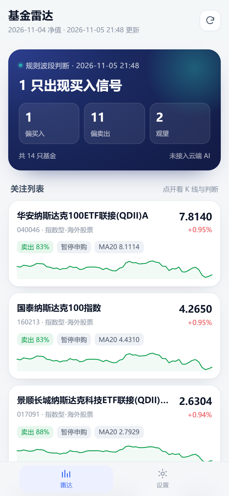
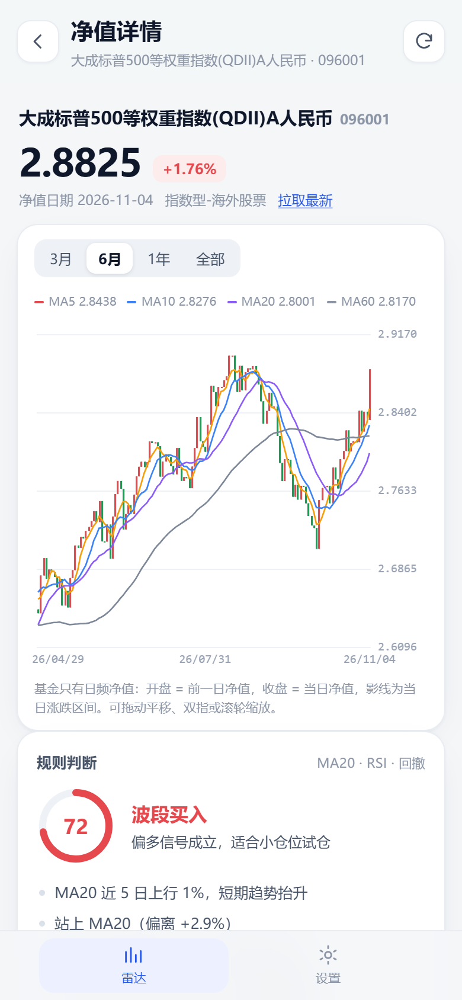

# 基金雷达 · Fund Radar

一个给自己用的基金监控台：**每天 14:35 自动算一遍 MA20 波段信号，AI 复核，Bark 推到手机**；随时打开网页就能看净值 K 线和判断依据。不用电脑常开，不用装 App，服务器也不要钱。

- 在线使用：<https://hukua1111.github.io/fund-radar/>
- iPhone：Safari 打开 → 分享 → 「添加到主屏幕」，之后像 App 一样全屏使用，更新自动生效
- 原有能力全部保留：限额变化监控、Bark 推送、`BARK_KEY` / `FUNDS` 配置一字未改，`state.json` 历史基线兼容

<p>
  
  
</p>

---

## 一、它能做什么

### 1. 净值 K 线
蜡烛图 + MA5 / MA10 / MA20 / MA60，支持 3 月 / 6 月 / 1 年 / 全部区间，可拖动平移、双指或滚轮缩放、长按十字光标查看当日净值与均线数值。

基金只有日频净值，没有盘中高低点，所以 K 线的画法是：**开盘 = 前一交易日净值，收盘 = 当日净值，最高/最低 = 两者取大/小**。影线只表示当天涨跌方向，界面上也写明了这一点。

### 2. 规则波段判断（离线也能算）
打开任意基金，本地立刻按下面的规则打分，不需要联网、不需要 AI：

| 因子 | 分值 | 逻辑 |
|---|---|---|
| 价格 vs MA20 | ±8 | 站上均线偏多 |
| MA20 近 5 日斜率 | ±10 | 中期趋势方向 |
| MA5 与 MA20 排列 | ±6 | 短期强弱 |
| 5 日内金叉 / 死叉 | ±7 | 拐点信号 |
| 偏离 MA20 的程度 | -12 ~ +8 | 贴均线加分，追高/破位减分 |
| RSI14 | -10 ~ +8 | 超买减分，超卖加分 |
| 距 60 日高点回撤 | -5 ~ +3 | 趋势是否受损 |
| MA20 与 MA60 | ±6 | 中期结构 |

分数 0–100：**≥62 判买入，≤38 判卖出，其余观望**；信心 = `50 + |分数-50| × 1.5`。每条结论都会给出对应的中文理由和建议仓位，不是黑箱。

### 3. AI 复核（点击即判）
K 线页下方有「让 AI 判断这次波段」按钮：
1. 把基金信息、8 个指标、近 45 个交易日（日期 / 净值 / 涨跌 / MA5 / MA20 / MA60）整理成结构化提示词
2. 直接请求你配置的任意 OpenAI 兼容接口（DeepSeek、Kimi、智谱、通义、OpenAI、本地 Ollama 都行）
3. 解析返回的 JSON，展示：波段买入/卖出/观望、信心、3–4 条依据、支撑阻力、建议仓位、风险

AI 不需要常驻，**只有点按钮或 14:35 定时任务时才调用**。没配 AI 时会退回落规则结论，界面不会空着。

### 4. 每天 14:35 自动跑 + Bark 推送
GitHub Actions 到点唤醒：

```
抓净值历史 → 算 MA 指标 → 规则判断 → AI 复核 → 写数据快照 → 推 Bark → 提交仓库
```

选 14:35 的原因：场外基金 15:00 前申购当天确认，判断完还来得及操作。推送示例：

```
11-05 波段判断 · 买1 卖11
买 1 · 卖 11 · 观望 2

大成标普500等权重 买入72%·趋势与位置共振，可分批建仓
华安纳斯达克100 卖出83%·偏空信号出现，逢反弹减仓
...
```

### 5. 安装与升级
是标准 PWA：`manifest.webmanifest` + Service Worker。安装后离线可看最近一次数据；发版时改 `docs/sw.js` 里的 `VERSION`，下次打开自动拉新并在后台切换，设置页也有「检查更新」。

---

## 二、三分钟用起来

### 第 1 步：打开应用
<https://hukua1111.github.io/fund-radar/>

列表默认显示仓库变量 `FUNDS` 里的基金。想加只给自己看的基金：**设置 → 关注列表 → 输入 6 位代码 → 添加**（只存在本机，不会提交到仓库）。

### 第 2 步：配置 AI（两种，任选）

**A. 本机判断（推荐先做，30 秒）**

设置 → AI 判断 → 选服务商（默认 DeepSeek）→ 填 API Key → 「测试连接」→ 保存。
Key 只存在这台设备的 `localStorage`，请求直接发往你填的接口，不经过任何中转。

**B. 云端判断（每天 14:35 自动跑）**

仓库 → Settings → Secrets and variables → Actions：

| 类型 | 名称 | 必填 | 说明 |
|---|---|---|---|
| Secret | `AI_KEY` | 云端 AI 必填 | 你的 AI Key |
| Variable | `AI_BASE_URL` | 否 | 默认 `https://api.deepseek.com/v1` |
| Variable | `AI_MODEL` | 否 | 默认 `deepseek-chat` |

配好后，14:35 的任务会用 AI 结论替换规则结论，并写进页面和推送。没配也能跑，只是走规则判断。

### 第 3 步：确认推送
`BARK_KEY` 沿用原来的配置，不用动。设置页可以填同一把 Key，点「发一条测试」验证手机能收到。

---

## 三、自动化时间线

| 时间（北京） | 任务 | 做什么 |
|---|---|---|
| 11:00 | `check.yml` | 查申购状态与限购额度，有变化才推 Bark |
| 14:35 | `daily-ai.yml` | 算指标 + AI 判断 + 更新网页数据 + 推 Bark |
| 随时 | Actions → Run workflow | 手动补跑一次 |

两个任务共用同一把并发锁，避免同时改仓库。定时任务由 GitHub 调度，**可能延迟几分钟到半小时**，这是平台特性。

---

## 四、配置项总表

| 名称 | 位置 | 默认 | 说明 |
|---|---|---|---|
| `BARK_KEY` | Secret | — | Bark 推送 Key（沿用原有配置） |
| `AI_KEY` | Secret | — | AI Key，不配则只用规则判断 |
| `FUNDS` | Variable | 原值 | 基金代码，逗号或空格分隔，最多 30 只 |
| `AI_BASE_URL` | Variable | DeepSeek | OpenAI 兼容接口地址 |
| `AI_MODEL` | Variable | `deepseek-chat` | 模型名 |
| `AI_NOTIFY` | Variable | `all` | `all` 每天都推；`signal` 只有买卖信号才推 |
| `ALWAYS_NOTIFY` | Variable | `0` | 限额检查每天必推 |

本地调试用的环境变量：`SKIP_PUSH=1` 不推送、`AI_MAX_FUNDS=5` 限制 AI 调用数量、`KLINE_POINTS=800` 调整 K 线保留长度。

---

## 五、目录

```
.
├── docs/                     GitHub Pages 静态站（PWA）
│   ├── index.html
│   ├── app.css / app.js      界面与交互
│   ├── sw.js / manifest.webmanifest
│   ├── lib/
│   │   ├── chart.js          Canvas 自绘 K 线（无第三方依赖）
│   │   ├── indicators.js     MA / RSI / 评分（浏览器与 Node 共用）
│   │   ├── ai-core.js        提示词、接口调用、JSON 解析
│   │   ├── store.js          本地存储与数据获取
│   │   └── live-worker.js    Worker 内加载净值脚本，隔离执行
│   ├── icons/
│   └── data/                 Actions 生成的数据快照
│       ├── funds.json        列表 + 指标 + 判断
│       ├── kline/<code>.json 每只基金近 400 个交易日
│       └── ai/latest.json    当日结论与历史
├── src/
│   ├── core.js               抓取、比对、推送（原有）
│   ├── gh-run.js             限额检查入口（原有）
│   └── daily-ai.js           每日波段判断入口
├── .github/workflows/
│   ├── check.yml             11:00 限额检查
│   └── daily-ai.yml          14:35 波段判断
├── tools/                    图标生成、本地预览
└── test.mjs                  71 项断言，不联网
```

---

## 六、本地开发

```bash
npm test          # 71 项断言，全部离线
npm run serve     # http://127.0.0.1:8788 预览前端
npm run ai        # 手动跑一次判断（需先 export FUNDS=...）
npm run icons     # 重新生成图标
```

连真实接口试一只基金：

```bash
FUNDS=005827 SKIP_PUSH=1 node src/daily-ai.js
```

---

## 七、需要知道的限制

**净值是 T-1 的。** 场外基金当天净值一般 19:00 后才公布，QDII 还要再晚 1 天。所以 14:35 的判断用的是「已公布的最新净值」，不是当天盘中的估值——这也是场外基金唯一能拿到的确定性数据。

**K 线是「伪 K 线」。** 基金没有盘中高低点和成交量，影线只代表当日涨跌，不要按股票的形态学去套。

**GitHub 定时不准点。** 14:35 的任务实际可能在 14:35–15:00 之间触发，偶尔会跳过。要准点只能上自己的服务器或 Cloudflare Worker。

**公开仓库意味着这些数据公开。** 基金代码、净值快照、判断结果都会出现在仓库里（`state.json` 本来就有）。本机添加的自选基金不会上传；AI Key 和 Bark Key 只存 Secret 或本机，不在仓库里。

**AI 会有幻觉。** 提示词已限制只能用给定数据、必须输出 JSON、数据不足必须给 hold，但仍可能出现离谱结论。它只是第二意见，最终下单的是你自己。

---

## 八、免责声明

数据来自东方财富公开接口，净值与限额以基金公司公告为准。所有判断都是基于历史净值的统计与模型输出，不构成投资建议，盈亏自负。
